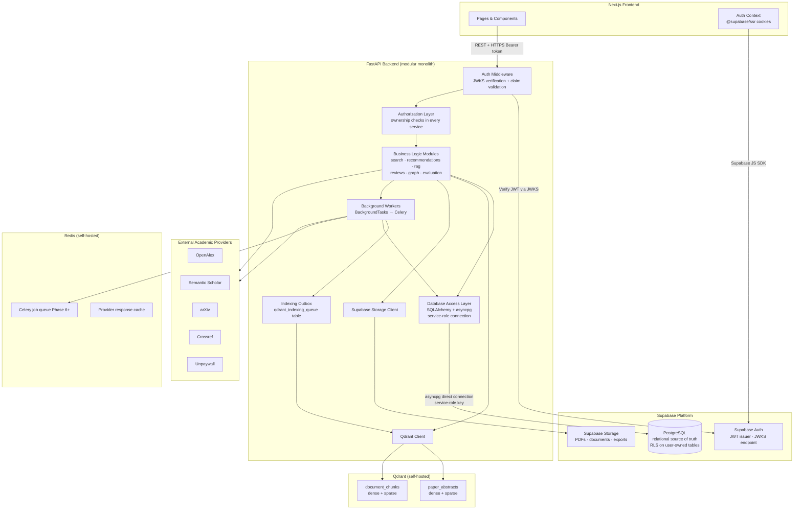

# PAPERTRAIL

## Research Intelligence & Discovery Platform

### Technical Architecture, Product Requirements and Engineering Implementation Blueprint

|  |  |
| --- | --- |
| **Document status** | Draft v0.3 (technical corrections — security, schema integrity, retrieval, RAG, evaluation, roadmap) |
| **Prepared for** | Akash Bhuyan |
| **Date** | 20 November 2026 |
| **External-fact access date** | 20 November 2026 |
| **Intended use** | Single source of truth for implementation, architecture review, GitHub documentation and interview preparation |

---

## Table of Contents

1. Executive Summary and Document Conventions
2. Part 1 — Product Vision and Problem Definition
3. Part 2 — Product Requirements Document
4. Part 3 — System Architecture
5. Part 4 — Data Engineering and Academic Data Integration
6. Part 5 — Database Design
7. Part 6 — Search and Information Retrieval Engine
8. Part 7 — Recommendation Engine
9. Part 8 — Document Processing and RAG Engineering
10. Part 9 — Literature Review Engine
11. Part 10 — Evaluation and Experimentation Framework
12. Part 11 — API Design
13. Part 12 — Frontend and User Experience
14. Part 13 — Security, Reliability and Observability
15. Part 14 — Testing and Quality Engineering
16. Part 15 — DevOps and Deployment
17. Part 16 — Phase-Wise Implementation Roadmap
18. Part 17 — Repository Structure and Conventions
19. Part 18 — Architecture Decision Records
20. Part 19 — Resume and Portfolio Engineering Value
21. Part 20 — Risk Register
22. Glossary
23. References and Official Documentation

---

# 1. Executive Summary and Document Conventions

## 1.1 Executive summary

PaperTrail is a research discovery platform whose value comes from retrieval engineering, data engineering and verifiable evidence handling. The system ingests scholarly metadata from public providers, normalizes and deduplicates it into one paper graph, indexes it for hybrid (lexical plus dense) retrieval with cross-encoder reranking, and lets users organize papers in a private workspace. For open-access full text it builds an evidence layer — parsed, structurally chunked, indexed passages — on which two evidence-grounded features run: a RAG research assistant and a Literature Review Studio. Every generated claim must map to a retrievable passage, and a separate two-layer validator checks that mapping. An Evaluation Lab makes every quality claim reproducible by running versioned experiments against a human-judged benchmark.

**What v0.3 corrects from v0.2**

v0.2 contained several technically inaccurate or incomplete specifications that would cause implementation failures:

1. **RLS policies were incomplete.** v0.2 defined only `USING` clauses. INSERT, UPDATE and DELETE operations require `WITH CHECK` clauses. Policies were also missing for `documents` and `document_chunks` when accessed by users. Corrected in Part 5.
2. **The citation validator was a single structural layer.** Checking that a chunk ID exists is not the same as checking that the passage supports the claim. Two independent layers are now specified. Corrected in Part 8.
3. **Filters were applied after reranking.** Metadata filters must be applied during Qdrant retrieval, not as a post-processing step, to avoid retrieving and reranking candidates that will be discarded. Corrected in Part 6.
4. **The outbox pattern was absent.** Relying on a periodic reconciliation job alone is insufficient for Qdrant consistency. An outbox table provides durable, ordered indexing events. Corrected in Part 6 and ADR-007.
5. **Background job infrastructure was over-specified.** Celery was introduced in Phase 1 without justification. FastAPI BackgroundTasks is sufficient through Phase 5; Celery is introduced only when PDF processing requires it. Corrected in Part 15 and ADR-012.
6. **paper_authors had a uniqueness gap.** The primary key `(paper_id, author_id)` allowed duplicate positions. Corrected in Part 5.
7. **paper_references required both papers to be ingested.** References to not-yet-ingested papers need a nullable `cited_paper_id` with a DOI fallback. Corrected in Part 5.
8. **The evaluation methodology conflated automated scores with ground truth.** Embedding similarity between a question and answer does not establish correctness. Human evaluation and automated evaluation are now explicitly separated. Corrected in Part 10.
9. **SSRF protection was absent.** URL-based PDF fetching requires validation against an allowlist of trusted domains. Added in Part 13.
10. **Supabase connection pooling was underspecified.** The implications of direct connections versus the session pooler versus the transaction pooler for async SQLAlchemy are now documented. Corrected in Part 15 and ADR-008.

**Five engineering bets that shape the whole design**

1. **Modular monolith, not microservices.** One FastAPI codebase with strict module boundaries. Supabase handles infrastructure; FastAPI handles intelligence (ADR-001).
2. **Hybrid retrieval is the default, but must earn its place.** BM25, dense, hybrid and hybrid-plus-reranking are all implemented as swappable strategies and compared on a benchmark. No retrieval claim is made before measurement.
3. **Provenance over convenience.** Every paper field records which provider supplied it and when. Every generated sentence links to a chunk, page and paper. Licensing and access status are first-class data.
4. **Untrusted input everywhere.** Provider data, PDFs and retrieved passages are treated as untrusted. Retrieved text is never an instruction channel. Supabase Auth tokens are verified server-side on every request.
5. **Evaluation is a product module.** Metrics are computed by code from stored judgments and runs; the UI shows pending states until a real run exists.

## 1.2 Document conventions

| Tag | Meaning | Rule |
| --- | --- | --- |
| **[C]** Confirmed | Verified against official documentation on the access date | Cite the source in References |
| **[D]** Design decision | A choice made in this blueprint, with rationale | Revisit only via an ADR |
| **[P]** Proposed | Recommended approach awaiting validation | Validation task listed |
| **[A]** Assumption | Believed true but not verified | Must be converted to [C] or dropped |
| **[U]** Unverified external dependency | External capability, limit, price or license to check | Phase 0 validation task |
| **[F]** Future | Deliberately out of current scope | Listed in the deferred-features table |

**Numbers policy.** All latency, throughput, quality and effort figures are provisional engineering targets, not measured results. Measured results live only in the Evaluation Lab and in a results register populated after real runs.

**Implementation policy.** Nothing may be described as implemented until code, tests and a recorded run exist.

---

# 2. Part 1 — Product Vision and Problem Definition

## 2.1 Product definition

PaperTrail is a research intelligence and discovery platform for researchers, students, engineers and technical professionals. Its capabilities are organized into five pillars, each backed by a concrete engineering subsystem.

| Pillar | What the user can do | Engineering subsystem |
| --- | --- | --- |
| Discover | Search scholarly literature with natural-language and fielded queries; filter by year, topic, venue, open-access status | Provider adapters, unified paper store, hybrid retrieval engine, reranker |
| Relate | Find related papers by semantic similarity and citation structure; explore a citation and topic graph | Recommendation engine, citation graph store, graph API |
| Organize | Save papers, build collections, write notes, tag, track reading status, compare papers | Relational workspace model with per-user isolation via RLS + FastAPI authorization |
| Synthesize | Generate structured literature reviews and evidence-grounded answers with claim-level citations | Document pipeline, chunk index, RAG orchestrator, two-layer citation validator |
| Evaluate | Reproduce retrieval and RAG quality measurements on a versioned benchmark | Evaluation engine, experiment tracker, Evaluation Lab UI |

## 2.2 Problem statement

| # | Problem | Root cause | PaperTrail engineering response |
| --- | --- | --- | --- |
| 1 | **Fragmented discovery** | No single provider covers all papers | Multi-provider adapters feeding a unified, provenance-tracked paper schema with DOI-first deduplication |
| 2 | **Keyword search limits** | Lexical match misses synonyms; dense-only misses exact terms | Hybrid BM25 plus dense retrieval with fusion and cross-encoder reranking, compared experimentally |
| 3 | **Hard to judge relevance** | Result lists lack reasons | Per-result explanations: matched terms, semantic neighbours, citation links |
| 4 | **Information overload** | Volume of new papers; no personal prioritization | Explainable, diverse, personalized recommendation using saved papers and reading history |
| 5 | **Relationships are hard to trace** | Citation links live in separate tools | Citation graph built only from real reference data, with progressive exploration |
| 6 | **Literature reviews take weeks** | Manual extraction across papers | Structured per-paper extraction with evidence pointers, then cross-paper synthesis |
| 7 | **AI summaries cannot be trusted** | Ungrounded generation; citations that exist but do not support the claim | Retrieval-grounded generation, two-layer citation validator (structural + semantic), insufficient-evidence path, Evaluation Lab |

## 2.3 Target users and personas

| Persona | Context | Jobs to be done |
| --- | --- | --- |
| **P1 Student surveyor** | Final-year or MS student writing a survey | Find the 20–40 papers that matter; draft a related-work comparison |
| **P2 Field-tracking researcher** | PhD student following a sub-field | Keep up with new work; discover papers that cite known ones |
| **P3 Applied ML engineer** | Industry engineer choosing a method | Compare methods and datasets; find known limitations |
| **P4 Reviewer or advisor** | Checks a student's claims | Verify that a claim is supported by a cited passage |

## 2.4 Product scope tiers

| Tier | Capabilities |
| --- | --- |
| **MVP** | Auth; ingestion from OpenAlex + arXiv + Crossref + Unpaywall; unified paper store with dedup; keyword and hybrid search with filters; paper detail; workspace (save, collections, notes, tags, reading status); basic Evaluation Lab with retrieval metrics |
| **Advanced** | Cross-encoder reranking; content-based and citation-based recommendations; OA PDF ingestion, parsing, chunk indexing; RAG with two-layer citation validation |
| **Research-grade** | Literature Review Studio; research graph; full Evaluation Lab with ablations, RAG metrics, experiment comparison |
| **Future [F]** | Collaborative workspaces; Zotero/BibTeX sync; email alerts; additional disciplines; learned personalization; browser extension |

**Non-goals for the first release [D]**
- No general-purpose chatbot as the primary interface
- No scraping of publisher sites or paywalled content
- No redistribution of full-text PDFs
- No fabricated metrics, placeholder research content or hardcoded recommendations in any production view
- No microservices without a documented bottleneck justification

---

# 3. Part 2 — Product Requirements Document

## 3.1 Functional requirements summary

- Real academic data only. No fabricated papers, citations, scores or metrics.
- All user workspace data persists in Supabase PostgreSQL with RLS enforcement.
- All generated claims link to retrievable source passages with two-layer validation.
- All evaluation metrics are computed from actual experiment runs.
- Empty and error states are shown honestly when data is unavailable.
- Every feature that depends on external credentials shows an honest pending or configuration-required state when credentials are absent.

## 3.2 Non-functional requirements

| Requirement | Target | Status |
| --- | --- | --- |
| Search latency p95 | < 2s hybrid without reranking | [P] provisional target |
| Search latency p95 with reranking | < 5s | [P] provisional target |
| RAG response latency p95 | < 15s end-to-end | [P] provisional target |
| Auth token verification | Every protected request, server-side | [D] required |
| RLS enforcement | All user-owned tables, all operations | [D] required |
| FastAPI authorization | All service methods, independent of RLS | [D] required |
| PDF size limit | 50 MB | [D] required |
| Pagination | All list endpoints | [D] required |
| API versioning | /api/v1/ prefix | [D] required |
| Request body size limit | 1 MB (except file upload endpoints) | [D] required |
| SSRF protection | URL allowlist for PDF fetching | [D] required |

---

# 4. Part 3 — System Architecture

## 3.1 Architecture overview

```
┌─────────────────────────────────────────────────────────────────────┐
│                        Next.js Frontend                             │
│  Homepage · Search · Paper Detail · Workspace · Reviews · Graph     │
│  Evaluation Lab · Auth pages                                        │
└───────────────────────────┬─────────────────────────────────────────┘
                            │ REST/JSON (HTTPS)
                            ▼
┌─────────────────────────────────────────────────────────────────────┐
│                     FastAPI Application Backend                     │
│                                                                     │
│  auth · papers · search · recommendations · workspace · documents   │
│  rag · reviews · graph · evaluation · ingestion · embeddings        │
│                                                                     │
│  ┌──────────────────────────────────────────────────────────────┐  │
│  │  Authorization layer (every service method, before DB call)  │  │
│  └──────────────────────────────────────────────────────────────┘  │
│                                                                     │
│  ┌──────────────────┐   ┌──────────────────────────────────────┐   │
│  │  Business Logic  │   │  Background Jobs                     │   │
│  │  (async FastAPI) │   │  Phase 1–5: FastAPI BackgroundTasks  │   │
│  │                  │   │  Phase 6+:  Celery + Redis           │   │
│  └────────┬─────────┘   └────────┬─────────────────────────────┘   │
└───────────┼──────────────────────┼──────────────────────────────────┘
            │                      │
     ┌──────┴──────────────────────┴──────┐
     │                                    │
     ▼                                    ▼
┌─────────────────────────┐   ┌───────────────────────┐
│     Supabase Platform   │   │    Qdrant (Docker)    │
│                         │   │                       │
│  ┌─────────────────┐    │   │  paper_abstracts      │
│  │  PostgreSQL DB  │    │   │  document_chunks      │
│  │  (relational    │    │   │                       │
│  │   source of     │    │   │  Dense + Sparse       │
│  │   truth)        │    │   │  vectors              │
│  └─────────────────┘    │   │  HNSW index           │
│  ┌─────────────────┐    │   │  Metadata payloads    │
│  │  Supabase Auth  │    │   └───────────────────────┘
│  │  (JWT issuer)   │    │
│  └─────────────────┘    │   ┌───────────────────────┐
│  ┌─────────────────┐    │   │    Redis (Docker)     │
│  │  Supabase       │    │   │  Celery job queue     │
│  │  Storage        │    │   │  Response cache       │
│  │  (PDFs, docs)   │    │   │  Rate-limit counters  │
│  └─────────────────┘    │   └───────────────────────┘
└─────────────────────────┘

External Academic Providers (read-only, rate-limited):
  OpenAlex · Semantic Scholar · arXiv · Crossref · Unpaywall
```

## 3.2 Mermaid architecture diagram



## 3.3 Data authority boundaries

| Data category | Authoritative store | Notes |
| --- | --- | --- |
| User identity and sessions | Supabase Auth | FastAPI verifies tokens; never issues them |
| Paper metadata, authors, topics | Supabase PostgreSQL | Globally readable; write-restricted to service role |
| User workspace data | Supabase PostgreSQL | RLS + FastAPI authorization |
| Literature review projects | Supabase PostgreSQL | RLS + FastAPI authorization |
| Evaluation datasets and results | Supabase PostgreSQL | Readable by authenticated users; written by backend |
| Paper and chunk vector representations | Qdrant | Derived from PostgreSQL; rebuilt via outbox + reconciliation |
| Permitted PDFs and user documents | Supabase Storage | Paths recorded in PostgreSQL; access via signed URLs |
| Job queue and response cache | Redis | Ephemeral; loss is recoverable |

## 3.4 Authorization model — two independent layers

**This is a critical design point.** FastAPI connects to PostgreSQL using the service-role key, which bypasses RLS. RLS therefore does NOT protect requests made through FastAPI's database connection. Two independent authorization layers are required:

**Layer 1 — FastAPI application authorization (primary)**
Every service method that touches user-owned data must verify ownership before executing any database operation:

```python
async def get_collection(
    collection_id: uuid.UUID,
    current_user: User,
    db: AsyncSession
) -> Collection:
    collection = await db.get(Collection, collection_id)
    if collection is None:
        raise HTTPException(404)
    if collection.user_id != current_user.id:   # ownership check
        raise HTTPException(403)
    return collection
```

This check runs before any read, update or delete. It is not optional.

**Layer 2 — PostgreSQL RLS (defense-in-depth)**
RLS policies protect direct database access (e.g., via Supabase dashboard, PostgREST, or any connection using the anon or authenticated role). They do not protect the service-role connection used by FastAPI. They are a second line of defense, not a substitute for application-level authorization.

**Role summary:**

| Role | Who uses it | RLS applies? | What it can access |
| --- | --- | --- | --- |
| `anon` | Unauthenticated browser requests via Supabase JS | Yes | Only explicitly public data |
| `authenticated` | Authenticated browser requests via Supabase JS | Yes | Own rows only (per RLS policies) |
| `service_role` | FastAPI backend via SQLAlchemy | No (bypasses RLS) | All rows — authorization enforced by FastAPI |

**The service-role key must never reach the browser.** It is a backend-only secret.

## 3.5 Authentication flow

```
1. User submits credentials via Supabase JS SDK (@supabase/ssr)
2. Supabase Auth returns access_token (JWT, 1h expiry) + refresh_token
3. @supabase/ssr stores tokens in httpOnly, Secure, SameSite=Lax cookies
   — never in localStorage or sessionStorage
4. Next.js middleware reads the cookie and forwards the access_token
   as Authorization: Bearer <token> on every API request to FastAPI
5. FastAPI auth middleware:
   a. Fetches Supabase JWKS (cached with TTL, refreshed on key rotation)
   b. Verifies JWT signature using the matching public key
   c. Validates: algorithm (HS256 or RS256 per project config [U]),
      issuer (https://<project>.supabase.co/auth/v1),
      audience (authenticated),
      expiry (not expired),
      sub claim (non-empty UUID)
   d. Injects verified user_id (sub) into request state
6. All downstream service methods use request.state.user_id
   — never a value supplied in the request body or query string
7. Token refresh is handled by @supabase/ssr middleware in Next.js
   — FastAPI never issues or refreshes tokens
8. Logout: Supabase JS SDK revokes the session;
   FastAPI has no session state to clear
```

**JWKS caching:** The JWKS endpoint is fetched once at startup and cached. A background task refreshes it every 24 hours and on 401 responses that indicate a key rotation. The `python-jose` or `PyJWT` library is used for verification — not a custom implementation.

## 3.6 FastAPI module structure

```
backend/app/
  core/           config, db session factory, logging, pagination, errors, security
  auth/           jwks_client, token_verifier, dependencies (get_current_user)
  providers/      base_adapter, openalex, semantic_scholar, arxiv, crossref, unpaywall
  ingestion/      orchestrator, normalizer, deduplicator, job_tracker
  papers/         router, service, repository, schemas
  search/         query_preprocessor, bm25_retriever, dense_retriever,
                  hybrid_fusion, reranker, result_explainer
  embeddings/     model_wrapper, batch_generator, model_registry
  documents/      fetcher, ssrf_guard, parser_interface, grobid_parser,
                  pypdf_parser, chunker, pipeline
  rag/            orchestrator, context_builder, llm_provider,
                  structural_validator, semantic_validator, claim_extractor
  recommendations/ content_ranker, citation_ranker, personalized_ranker,
                   diversity_filter, explainer
  workspace/      collections, saved_papers, notes, tags, reading_progress
  reviews/        projects, synthesis_generator, matrix_builder, exporter
  graph/          query_builder, edge_resolver
  evaluation/     metrics, experiment_runner, benchmark_manager
  storage/        supabase_storage_client
  outbox/         indexing_queue, worker
```

Each module: one router, one service layer, one repository layer. No module imports another module's repository directly.


---

# 5. Part 4 — Data Engineering and Academic Data Integration

## 4.1 Provider adapter design

Each provider implements a common protocol. The protocol is defined in plain Python — no framework dependency.

```python
class ProviderAdapter(Protocol):
    provider_name: str

    async def search(
        self, query: str, page: int = 1, page_size: int = 20, **filters
    ) -> ProviderSearchResult: ...

    async def fetch_by_id(self, provider_id: str) -> RawPaper | None: ...

    async def fetch_references(self, provider_id: str) -> list[RawReference]: ...

    async def fetch_citations(self, provider_id: str) -> list[RawReference]: ...
```

All adapters are wrapped with:
- Exponential backoff retry via `tenacity` (max 3 attempts, jitter)
- Per-provider token-bucket rate limiter (in-process for single worker; Redis-backed when Celery is active)
- Redis response cache (TTL configurable per provider; default 1 hour for search, 24 hours for paper detail)
- Structured log entry per request including provider, endpoint, status code, latency

## 4.2 Provider specifications

All rate limits below are marked [U] — they must be verified against current official documentation before Phase 2 begins. Do not treat these as confirmed values.

| Provider | What we use | Auth | Rate limit [U] | Key risks |
| --- | --- | --- | --- | --- |
| OpenAlex | Paper metadata, citations, concepts, institutions | Email param (`mailto=`) for polite pool | 10 req/s polite pool [U] | Pricing model changed; verify daily budget before use |
| Semantic Scholar | Metadata, references, related papers | API key (free tier registration) | 1 req/s without key; 10 req/s with key [U] | Abstract-only without separate full-text agreement; bulk endpoints differ |
| arXiv | Metadata + OA PDFs | None | 3 req/s [U]; OAI-PMH for bulk harvest | XML Atom feed; PDF access permitted under arXiv license for text mining |
| Crossref | DOI resolution, bibliographic data | Email param (`mailto=`) for polite pool | 50 req/s polite pool [U] | Metadata completeness varies; many arXiv papers have incomplete Crossref records |
| Unpaywall | OA PDF URLs | Email param required | 100k req/day [U] | URL availability not guaranteed; some URLs return 404 or redirect to paywalled versions |

## 4.3 Normalized paper model

All provider responses are normalized before persistence. Field-level provenance is tracked where practical.

```python
@dataclass
class NormalizedAuthor:
    name: str                    # required
    family_name: str | None      # for dedup fallback
    orcid: str | None
    institution: str | None
    position: int                # 1-based author order

@dataclass
class NormalizedPaper:
    # Identity
    doi: str | None              # None if provider does not supply one
    title: str                   # required; never fabricated
    # Metadata
    abstract: str | None         # None if not provided — not fabricated
    year: int | None
    venue: str | None
    volume: str | None
    issue: str | None
    pages: str | None
    # Access
    open_access: bool
    oa_url: str | None           # None if not OA or URL not available
    access_license: str | None   # e.g. 'cc-by-4.0', 'arxiv-non-exclusive'
    # Relationships
    authors: list[NormalizedAuthor]
    topics: list[str]
    reference_dois: list[str]    # DOIs of references; may be empty
    # Provenance
    source_provider: str
    provider_id: str
    raw_metadata: dict           # original provider response, stored as-is
    fetched_at: datetime
    # Metadata availability flags — distinguish missing from unavailable
    has_abstract: bool
    has_references: bool
    has_full_text_url: bool
```

**Missing vs unavailable distinction:** `abstract = None` means the provider did not supply one. It does not mean the abstract does not exist. The UI must distinguish "abstract not available from this source" from "paper has no abstract."

## 4.4 Deduplication strategy

Deduplication runs in this order before any INSERT:

1. **DOI match** — normalize DOI (lowercase, strip `https://doi.org/` prefix). If a paper with this DOI exists, treat as the same paper.
2. **Title + author + year match** — normalize title (lowercase, strip punctuation, collapse whitespace). If normalized title + first author family name (lowercase) + year matches an existing paper, treat as the same paper. This catches arXiv papers that later receive a DOI.
3. **Provider ID cross-reference** — check `paper_sources` for an existing record with the same `(provider, provider_id)`.

When a match is found:
- Add a new `paper_sources` record for the new provider
- Update `papers` fields only where the existing value is NULL (never overwrite confirmed data with potentially lower-quality data)
- Log the merge decision with both provider IDs

When no match is found:
- Insert a new `papers` record
- Insert the first `paper_sources` record

## 4.5 Author and institution normalization

Author identity is a known hard problem. The approach is conservative:

- Authors are matched by ORCID when available (reliable)
- Without ORCID, a new author record is created per paper — no automatic name-based merging
- Name-based author merging is deferred to a future reconciliation step [F]
- Institution names are stored as-is from the provider; ROR ID is stored when available

## 4.6 Full-text access policy

Only ingest or process full text when access and licensing explicitly permit it.

| Access type | Condition | Stored as |
| --- | --- | --- |
| `arxiv_oa` | arXiv paper; arXiv non-exclusive license permits text mining [A — verify] | `documents.access_type = 'arxiv_oa'` |
| `unpaywall_oa` | Unpaywall returns a gold/green OA URL | `documents.access_type = 'unpaywall_oa'` |
| `user_upload` | User uploads a document and asserts they have the right to process it | `documents.access_type = 'user_upload'` |

Processing never begins without a recorded `access_type`. An Open Access label on a paper does not automatically grant permission to download and redistribute the PDF — the specific license must be checked.

## 4.7 Ingestion job state machine

```
pending → running → completed
                 → partial_failure  (some papers failed; job continues)
                 → failed           (unrecoverable error; job stops)
```

State transitions are recorded in `ingestion_jobs`. The API exposes job status. The frontend shows honest progress — never a fake progress bar.

## 4.8 Idempotency

Every ingestion operation is idempotent. Running the same ingestion job twice produces the same database state. This is enforced by:
- `ON CONFLICT DO NOTHING` or `ON CONFLICT DO UPDATE` on all INSERT operations
- Checking for existing `paper_sources` records before fetching provider detail
- Storing `fetched_at` to support freshness-based re-fetch decisions


---

# 6. Part 5 — Database Design

## 5.1 Schema categories

**Globally shared academic data** — readable by all authenticated users; written only by the ingestion pipeline via the service role:
`papers, authors, institutions, paper_authors, paper_references, paper_sources, paper_topics`

**User-owned private data** — isolated per user via RLS AND FastAPI authorization:
`profiles, collections, collection_papers, saved_papers, notes, tags, paper_tags, reading_progress, literature_reviews, literature_review_papers, synthesis_sections, evidence_citations, recommendation_events`

**System data** — written by backend services; readable by authenticated users:
`documents, document_chunks, evaluation_datasets, relevance_judgments, retrieval_experiments, evaluation_results, ingestion_jobs, qdrant_indexing_queue`

## 5.2 Full schema definition

```sql
-- ============================================================
-- EXTENSIONS
-- ============================================================
create extension if not exists "uuid-ossp";
create extension if not exists "pg_trgm";  -- for fuzzy author name search

-- ============================================================
-- PROFILES
-- ============================================================
create table profiles (
  id           uuid primary key references auth.users(id) on delete cascade,
  display_name text,
  bio          text,
  interests    text[] not null default '{}',
  created_at   timestamptz not null default now(),
  updated_at   timestamptz not null default now()
);

-- Auto-create profile on user signup via Supabase Auth trigger
create or replace function handle_new_user()
returns trigger language plpgsql security definer set search_path = public as $$
begin
  insert into profiles (id) values (new.id)
  on conflict (id) do nothing;
  return new;
end;
$$;

create trigger on_auth_user_created
  after insert on auth.users
  for each row execute procedure handle_new_user();

-- ============================================================
-- GLOBALLY SHARED ACADEMIC DATA
-- ============================================================
create table papers (
  id           uuid primary key default uuid_generate_v4(),
  doi          text,
  title        text not null,
  abstract     text,
  year         smallint check (year > 1000 and year <= 2100),
  venue        text,
  volume       text,
  issue        text,
  pages        text,
  open_access  boolean not null default false,
  oa_url       text,
  has_abstract boolean not null default false,
  has_references boolean not null default false,
  created_at   timestamptz not null default now(),
  updated_at   timestamptz not null default now(),
  constraint papers_doi_unique unique (doi),
  constraint papers_doi_format check (doi is null or doi not like 'https://%')
);
-- doi stored without URL prefix; normalized on insert
create index on papers (year);
create index on papers (open_access);
create index on papers using gin (
  to_tsvector('english', coalesce(title,'') || ' ' || coalesce(abstract,''))
);
create index on papers (lower(title) text_pattern_ops);

create table authors (
  id           uuid primary key default uuid_generate_v4(),
  name         text not null,
  family_name  text,
  orcid        text,
  created_at   timestamptz not null default now(),
  constraint authors_orcid_unique unique (orcid)
  -- orcid unique only when non-null; enforced by partial index:
);
create unique index authors_orcid_notnull on authors (orcid) where orcid is not null;
create index on authors using gin (name gin_trgm_ops);

create table institutions (
  id      uuid primary key default uuid_generate_v4(),
  name    text not null,
  ror_id  text,
  country text,
  constraint institutions_name_unique unique (name),
  constraint institutions_ror_unique unique (ror_id)
);

create table paper_authors (
  paper_id   uuid not null references papers(id) on delete cascade,
  author_id  uuid not null references authors(id) on delete restrict,
  position   smallint not null check (position >= 1),
  primary key (paper_id, author_id),
  -- prevent duplicate positions for the same paper
  constraint paper_authors_position_unique unique (paper_id, position)
);
create index on paper_authors (author_id);

create table paper_sources (
  id            uuid primary key default uuid_generate_v4(),
  paper_id      uuid not null references papers(id) on delete cascade,
  provider      text not null,
  provider_id   text not null,
  raw_metadata  jsonb not null default '{}',
  fetched_at    timestamptz not null default now(),
  constraint paper_sources_provider_id_unique unique (provider, provider_id)
);
create index on paper_sources (paper_id);
create index on paper_sources (provider, provider_id);

-- References: cited_paper_id is nullable to support references to
-- papers not yet ingested. doi_fallback stores the reference DOI
-- so the relationship can be resolved later.
create table paper_references (
  id               uuid primary key default uuid_generate_v4(),
  citing_paper_id  uuid not null references papers(id) on delete cascade,
  cited_paper_id   uuid references papers(id) on delete set null,
  doi_fallback     text,  -- used when cited_paper_id is null
  source           text not null,
  constraint paper_references_unique unique (citing_paper_id, coalesce(cited_paper_id::text, doi_fallback)),
  constraint paper_references_has_target check (
    cited_paper_id is not null or doi_fallback is not null
  )
);
create index on paper_references (citing_paper_id);
create index on paper_references (cited_paper_id);
create index on paper_references (doi_fallback) where doi_fallback is not null;

create table paper_topics (
  paper_id  uuid not null references papers(id) on delete cascade,
  topic     text not null,
  source    text not null,
  score     real,
  primary key (paper_id, topic, source)
);
create index on paper_topics (topic);

-- ============================================================
-- DOCUMENTS AND CHUNKS
-- ============================================================
create table documents (
  id            uuid primary key default uuid_generate_v4(),
  paper_id      uuid not null references papers(id) on delete cascade,
  source_url    text not null,
  access_type   text not null check (
    access_type in ('arxiv_oa','unpaywall_oa','user_upload')
  ),
  storage_path  text,
  file_checksum text,  -- SHA-256 of the downloaded file for dedup
  parse_status  text not null default 'pending' check (
    parse_status in ('pending','processing','complete','failed')
  ),
  parser_used   text,  -- 'grobid' | 'pypdf'
  page_count    int check (page_count > 0),
  parsed_at     timestamptz,
  created_at    timestamptz not null default now(),
  -- prevent duplicate ingestion of the same file
  constraint documents_checksum_unique unique (file_checksum)
);
create index on documents (paper_id);
create index on documents (parse_status);

create table document_chunks (
  id            uuid primary key default uuid_generate_v4(),
  document_id   uuid not null references documents(id) on delete cascade,
  paper_id      uuid not null references papers(id) on delete cascade,
  chunk_index   int not null check (chunk_index >= 0),
  text          text not null,
  page_number   int check (page_number >= 1),
  char_offset   int check (char_offset >= 0),  -- character offset in document
  section       text,
  token_count   int check (token_count > 0),
  qdrant_id     uuid,  -- point ID in Qdrant; UUID type, not text
  created_at    timestamptz not null default now(),
  constraint document_chunks_unique unique (document_id, chunk_index)
);
create unique index document_chunks_qdrant_id on document_chunks (qdrant_id)
  where qdrant_id is not null;
create index on document_chunks (paper_id);
create index on document_chunks (document_id, chunk_index);

-- ============================================================
-- OUTBOX FOR QDRANT INDEXING
-- ============================================================
create table qdrant_indexing_queue (
  id           uuid primary key default uuid_generate_v4(),
  entity_type  text not null check (entity_type in ('paper','chunk')),
  entity_id    uuid not null,
  operation    text not null check (operation in ('upsert','delete')),
  status       text not null default 'pending' check (
    status in ('pending','processing','done','failed')
  ),
  attempts     int not null default 0,
  last_error   text,
  created_at   timestamptz not null default now(),
  processed_at timestamptz
);
create index on qdrant_indexing_queue (status, created_at)
  where status in ('pending','failed');

-- ============================================================
-- USER-OWNED WORKSPACE DATA
-- ============================================================
create table collections (
  id          uuid primary key default uuid_generate_v4(),
  user_id     uuid not null references auth.users(id) on delete cascade,
  name        text not null check (length(trim(name)) > 0),
  description text,
  created_at  timestamptz not null default now(),
  updated_at  timestamptz not null default now(),
  constraint collections_user_name_unique unique (user_id, name)
);
create index on collections (user_id);

create table collection_papers (
  collection_id  uuid not null references collections(id) on delete cascade,
  paper_id       uuid not null references papers(id) on delete cascade,
  added_at       timestamptz not null default now(),
  primary key (collection_id, paper_id)
);
create index on collection_papers (paper_id);

create table saved_papers (
  id        uuid primary key default uuid_generate_v4(),
  user_id   uuid not null references auth.users(id) on delete cascade,
  paper_id  uuid not null references papers(id) on delete cascade,
  saved_at  timestamptz not null default now(),
  constraint saved_papers_unique unique (user_id, paper_id)
);
create index on saved_papers (user_id);

create table notes (
  id         uuid primary key default uuid_generate_v4(),
  user_id    uuid not null references auth.users(id) on delete cascade,
  paper_id   uuid not null references papers(id) on delete cascade,
  content    text not null check (length(content) > 0),
  created_at timestamptz not null default now(),
  updated_at timestamptz not null default now()
);
create index on notes (user_id, paper_id);

create table tags (
  id      uuid primary key default uuid_generate_v4(),
  user_id uuid not null references auth.users(id) on delete cascade,
  name    text not null check (length(trim(name)) > 0),
  constraint tags_user_name_unique unique (user_id, name)
);
create index on tags (user_id);

create table paper_tags (
  paper_id  uuid not null references papers(id) on delete cascade,
  tag_id    uuid not null references tags(id) on delete cascade,
  user_id   uuid not null references auth.users(id) on delete cascade,
  tagged_at timestamptz not null default now(),
  primary key (paper_id, tag_id, user_id)
);
create index on paper_tags (user_id, paper_id);

create table reading_progress (
  id         uuid primary key default uuid_generate_v4(),
  user_id    uuid not null references auth.users(id) on delete cascade,
  paper_id   uuid not null references papers(id) on delete cascade,
  status     text not null check (status in ('to_read','reading','read','archived')),
  updated_at timestamptz not null default now(),
  constraint reading_progress_unique unique (user_id, paper_id)
);
create index on reading_progress (user_id, status);

-- ============================================================
-- LITERATURE REVIEWS
-- ============================================================
create table literature_reviews (
  id          uuid primary key default uuid_generate_v4(),
  user_id     uuid not null references auth.users(id) on delete cascade,
  title       text not null check (length(trim(title)) > 0),
  description text,
  status      text not null default 'draft' check (
    status in ('draft','generating','complete','error')
  ),
  created_at  timestamptz not null default now(),
  updated_at  timestamptz not null default now()
);
create index on literature_reviews (user_id, updated_at desc);

create table literature_review_papers (
  review_id  uuid not null references literature_reviews(id) on delete cascade,
  paper_id   uuid not null references papers(id) on delete cascade,
  added_at   timestamptz not null default now(),
  primary key (review_id, paper_id)
);

create table synthesis_sections (
  id             uuid primary key default uuid_generate_v4(),
  review_id      uuid not null references literature_reviews(id) on delete cascade,
  section_type   text not null check (section_type in (
    'overview','themes','methodologies','findings',
    'similarities','contradictions','limitations','gaps','future_directions'
  )),
  content        text,
  generated_at   timestamptz,
  model_id       text,   -- e.g. 'gpt-4o-2024-08-06'
  model_version  text,
  is_abstract_only boolean not null default false,
  constraint synthesis_sections_unique unique (review_id, section_type)
);
create index on synthesis_sections (review_id);

create table evidence_citations (
  id                  uuid primary key default uuid_generate_v4(),
  section_id          uuid not null references synthesis_sections(id) on delete cascade,
  chunk_id            uuid references document_chunks(id) on delete set null,
  paper_id            uuid not null references papers(id) on delete cascade,
  passage             text not null,
  claim_text          text not null,
  page_number         int,
  section_ref         text,
  -- Layer 1: structural validation
  structural_valid    boolean,
  -- Layer 2: semantic validation
  semantic_valid      boolean,
  semantic_score      real,  -- similarity score from semantic validator
  validation_note     text,  -- reason for failure if invalid
  validated_at        timestamptz
);
create index on evidence_citations (section_id);
create index on evidence_citations (paper_id);
create index on evidence_citations (chunk_id) where chunk_id is not null;

-- ============================================================
-- EVALUATION
-- ============================================================
create table evaluation_datasets (
  id          uuid primary key default uuid_generate_v4(),
  name        text not null,
  version     text not null,
  description text,
  domain      text not null default 'ai_cs',
  created_at  timestamptz not null default now(),
  constraint evaluation_datasets_unique unique (name, version)
);

create table relevance_judgments (
  id           uuid primary key default uuid_generate_v4(),
  dataset_id   uuid not null references evaluation_datasets(id) on delete cascade,
  query        text not null,
  paper_id     uuid not null references papers(id) on delete cascade,
  relevance    smallint not null check (relevance in (0,1,2)),
  annotator    text not null,  -- 'human:<name>' or 'imported:<source>'
  source       text not null,  -- provenance description
  judged_at    timestamptz not null default now(),
  -- allow multiple annotators per (dataset, query, paper)
  constraint relevance_judgments_unique unique (dataset_id, query, paper_id, annotator)
);
create index on relevance_judgments (dataset_id, query);

create table retrieval_experiments (
  id              uuid primary key default uuid_generate_v4(),
  name            text not null,
  strategy        text not null check (
    strategy in ('bm25_only','dense_only','hybrid_rrf','hybrid_rerank')
  ),
  config          jsonb not null,
  dataset_id      uuid references evaluation_datasets(id),
  embedding_model text not null,
  reranker_model  text,
  index_version   text,  -- version tag of the Qdrant index used
  status          text not null default 'pending' check (
    status in ('pending','running','complete','failed')
  ),
  created_at      timestamptz not null default now(),
  completed_at    timestamptz
);

create table evaluation_results (
  id             uuid primary key default uuid_generate_v4(),
  experiment_id  uuid not null references retrieval_experiments(id) on delete cascade,
  metric         text not null,
  value          numeric not null,
  k              smallint,
  computed_at    timestamptz not null default now(),
  constraint evaluation_results_unique unique (experiment_id, metric, k)
);
create index on evaluation_results (experiment_id);

-- ============================================================
-- INGESTION JOBS
-- ============================================================
create table ingestion_jobs (
  id               uuid primary key default uuid_generate_v4(),
  provider         text not null,
  query_or_scope   text,
  status           text not null default 'pending' check (
    status in ('pending','running','partial_failure','completed','failed')
  ),
  papers_found     int not null default 0,
  papers_inserted  int not null default 0,
  papers_updated   int not null default 0,
  errors           jsonb not null default '[]',
  started_at       timestamptz,
  completed_at     timestamptz,
  created_at       timestamptz not null default now()
);
create index on ingestion_jobs (status, created_at desc);

-- ============================================================
-- RECOMMENDATION EVENTS
-- ============================================================
create table recommendation_events (
  id          uuid primary key default uuid_generate_v4(),
  user_id     uuid not null references auth.users(id) on delete cascade,
  paper_id    uuid not null references papers(id) on delete cascade,
  event_type  text not null check (
    event_type in ('view','save','dismiss','click','not_relevant')
  ),
  source      text,  -- 'content_based' | 'citation_based' | 'personalized'
  created_at  timestamptz not null default now()
);
create index on recommendation_events (user_id, created_at desc);
create index on recommendation_events (user_id, paper_id);
```

## 5.3 Row Level Security — complete policies

RLS protects direct database access via the `anon` and `authenticated` roles (Supabase JS SDK, PostgREST). It does NOT protect the service-role connection used by FastAPI. FastAPI enforces authorization independently.

```sql
-- ============================================================
-- ENABLE RLS ON ALL USER-OWNED AND SENSITIVE TABLES
-- ============================================================
alter table profiles                  enable row level security;
alter table collections               enable row level security;
alter table collection_papers         enable row level security;
alter table saved_papers              enable row level security;
alter table notes                     enable row level security;
alter table tags                      enable row level security;
alter table paper_tags                enable row level security;
alter table reading_progress          enable row level security;
alter table literature_reviews        enable row level security;
alter table literature_review_papers  enable row level security;
alter table synthesis_sections        enable row level security;
alter table evidence_citations        enable row level security;
alter table recommendation_events     enable row level security;
-- System tables: authenticated users can read, only service role can write
alter table documents                 enable row level security;
alter table document_chunks           enable row level security;
alter table ingestion_jobs            enable row level security;
alter table qdrant_indexing_queue     enable row level security;

-- ============================================================
-- PROFILES
-- ============================================================
create policy "profiles_select_own" on profiles
  for select using (id = auth.uid());

create policy "profiles_insert_own" on profiles
  for insert with check (id = auth.uid());

create policy "profiles_update_own" on profiles
  for update using (id = auth.uid()) with check (id = auth.uid());

-- ============================================================
-- COLLECTIONS
-- ============================================================
create policy "collections_select_own" on collections
  for select using (user_id = auth.uid());

create policy "collections_insert_own" on collections
  for insert with check (user_id = auth.uid());

create policy "collections_update_own" on collections
  for update using (user_id = auth.uid()) with check (user_id = auth.uid());

create policy "collections_delete_own" on collections
  for delete using (user_id = auth.uid());

-- ============================================================
-- COLLECTION PAPERS
-- ============================================================
create policy "collection_papers_select_own" on collection_papers
  for select using (
    collection_id in (select id from collections where user_id = auth.uid())
  );

create policy "collection_papers_insert_own" on collection_papers
  for insert with check (
    collection_id in (select id from collections where user_id = auth.uid())
  );

create policy "collection_papers_delete_own" on collection_papers
  for delete using (
    collection_id in (select id from collections where user_id = auth.uid())
  );

-- ============================================================
-- SAVED PAPERS
-- ============================================================
create policy "saved_papers_select_own" on saved_papers
  for select using (user_id = auth.uid());

create policy "saved_papers_insert_own" on saved_papers
  for insert with check (user_id = auth.uid());

create policy "saved_papers_delete_own" on saved_papers
  for delete using (user_id = auth.uid());

-- ============================================================
-- NOTES
-- ============================================================
create policy "notes_select_own" on notes
  for select using (user_id = auth.uid());

create policy "notes_insert_own" on notes
  for insert with check (user_id = auth.uid());

create policy "notes_update_own" on notes
  for update using (user_id = auth.uid()) with check (user_id = auth.uid());

create policy "notes_delete_own" on notes
  for delete using (user_id = auth.uid());

-- ============================================================
-- TAGS
-- ============================================================
create policy "tags_select_own" on tags
  for select using (user_id = auth.uid());

create policy "tags_insert_own" on tags
  for insert with check (user_id = auth.uid());

create policy "tags_update_own" on tags
  for update using (user_id = auth.uid()) with check (user_id = auth.uid());

create policy "tags_delete_own" on tags
  for delete using (user_id = auth.uid());

-- ============================================================
-- PAPER TAGS
-- ============================================================
create policy "paper_tags_select_own" on paper_tags
  for select using (user_id = auth.uid());

create policy "paper_tags_insert_own" on paper_tags
  for insert with check (user_id = auth.uid());

create policy "paper_tags_delete_own" on paper_tags
  for delete using (user_id = auth.uid());

-- ============================================================
-- READING PROGRESS
-- ============================================================
create policy "reading_progress_select_own" on reading_progress
  for select using (user_id = auth.uid());

create policy "reading_progress_insert_own" on reading_progress
  for insert with check (user_id = auth.uid());

create policy "reading_progress_update_own" on reading_progress
  for update using (user_id = auth.uid()) with check (user_id = auth.uid());

create policy "reading_progress_delete_own" on reading_progress
  for delete using (user_id = auth.uid());

-- ============================================================
-- LITERATURE REVIEWS
-- ============================================================
create policy "literature_reviews_select_own" on literature_reviews
  for select using (user_id = auth.uid());

create policy "literature_reviews_insert_own" on literature_reviews
  for insert with check (user_id = auth.uid());

create policy "literature_reviews_update_own" on literature_reviews
  for update using (user_id = auth.uid()) with check (user_id = auth.uid());

create policy "literature_reviews_delete_own" on literature_reviews
  for delete using (user_id = auth.uid());

-- ============================================================
-- LITERATURE REVIEW PAPERS
-- ============================================================
create policy "review_papers_select_own" on literature_review_papers
  for select using (
    review_id in (select id from literature_reviews where user_id = auth.uid())
  );

create policy "review_papers_insert_own" on literature_review_papers
  for insert with check (
    review_id in (select id from literature_reviews where user_id = auth.uid())
  );

create policy "review_papers_delete_own" on literature_review_papers
  for delete using (
    review_id in (select id from literature_reviews where user_id = auth.uid())
  );

-- ============================================================
-- SYNTHESIS SECTIONS
-- ============================================================
create policy "synthesis_sections_select_own" on synthesis_sections
  for select using (
    review_id in (select id from literature_reviews where user_id = auth.uid())
  );

create policy "synthesis_sections_insert_own" on synthesis_sections
  for insert with check (
    review_id in (select id from literature_reviews where user_id = auth.uid())
  );

create policy "synthesis_sections_update_own" on synthesis_sections
  for update using (
    review_id in (select id from literature_reviews where user_id = auth.uid())
  ) with check (
    review_id in (select id from literature_reviews where user_id = auth.uid())
  );

create policy "synthesis_sections_delete_own" on synthesis_sections
  for delete using (
    review_id in (select id from literature_reviews where user_id = auth.uid())
  );

-- ============================================================
-- EVIDENCE CITATIONS
-- ============================================================
create policy "evidence_citations_select_own" on evidence_citations
  for select using (
    section_id in (
      select s.id from synthesis_sections s
      join literature_reviews r on r.id = s.review_id
      where r.user_id = auth.uid()
    )
  );

create policy "evidence_citations_insert_own" on evidence_citations
  for insert with check (
    section_id in (
      select s.id from synthesis_sections s
      join literature_reviews r on r.id = s.review_id
      where r.user_id = auth.uid()
    )
  );

-- ============================================================
-- RECOMMENDATION EVENTS
-- ============================================================
create policy "recommendation_events_select_own" on recommendation_events
  for select using (user_id = auth.uid());

create policy "recommendation_events_insert_own" on recommendation_events
  for insert with check (user_id = auth.uid());

-- ============================================================
-- DOCUMENTS AND CHUNKS — authenticated users can read
-- ============================================================
create policy "documents_select_authenticated" on documents
  for select using (auth.role() = 'authenticated');

create policy "document_chunks_select_authenticated" on document_chunks
  for select using (auth.role() = 'authenticated');

-- No INSERT/UPDATE/DELETE policies for documents/chunks via RLS
-- — only the service role (FastAPI) writes these tables

-- ============================================================
-- INGESTION JOBS — authenticated users can read their own
-- (jobs are not user-scoped, so all authenticated users can read)
-- ============================================================
create policy "ingestion_jobs_select_authenticated" on ingestion_jobs
  for select using (auth.role() = 'authenticated');

-- qdrant_indexing_queue: no direct access via RLS; service role only
-- No policies defined — all access denied to anon/authenticated roles
```

## 5.4 Data integrity notes

**paper_authors duplicate position:** The `UNIQUE (paper_id, position)` constraint prevents two authors from having the same position on the same paper. The primary key `(paper_id, author_id)` prevents the same author appearing twice on the same paper.

**paper_references to unresolved papers:** `cited_paper_id` is nullable. `doi_fallback` stores the reference DOI when the cited paper is not yet in the database. A background job periodically resolves `doi_fallback` values against the `papers` table and fills in `cited_paper_id`.

**Document deduplication:** `file_checksum` (SHA-256) prevents the same PDF from being processed twice, even if fetched from different URLs.

**Evidence citation validation state:** `structural_valid` and `semantic_valid` are nullable booleans. NULL means validation has not run yet. The UI must distinguish unvalidated from validated-invalid.

**Profile creation:** The `handle_new_user` trigger creates a profile row automatically when a Supabase Auth user is created. This prevents orphaned auth users with no profile.

## 5.5 Supabase Storage buckets

| Bucket | Access | Contents | Constraints |
| --- | --- | --- | --- |
| `research-pdfs` | Private (service role writes; signed URL reads) | OA PDFs fetched by ingestion pipeline | Max 50MB, `application/pdf` only, path: `papers/{paper_id}/{sha256}.pdf` |
| `user-documents` | Private (owner only via signed URL) | User-uploaded research documents | Max 50MB, `application/pdf` only, path: `users/{user_id}/{doc_id}.pdf` |
| `review-exports` | Private (owner only via signed URL) | Generated literature review exports | Max 10MB, PDF/MD, path: `reviews/{user_id}/{review_id}.{ext}` |

Storage paths are recorded in `documents.storage_path`. Access is exclusively via server-generated signed URLs with a configurable TTL (default 1 hour). The frontend never calls Supabase Storage directly for private content.


---

# 7. Part 6 — Search and Information Retrieval Engine

## 6.1 Retrieval pipeline — corrected stage order

**Critical correction from v0.2:** Metadata filters must be applied during Qdrant retrieval, not after reranking. Applying filters post-retrieval wastes candidate slots and produces incorrect pagination counts.

```
Query string
  │
  ▼
1. Query preprocessing
   - Normalize whitespace, lowercase for BM25 tokenization
   - Detect field prefixes: author:, doi:, title:, year:
   - Length check: reject < 2 chars, truncate > 500 chars
   - Detect language (English assumed; log if non-English detected)

2. Filter construction
   - Parse filter params: year_from, year_to, topics[], open_access,
     source_providers[], author_name
   - Build Qdrant filter object BEFORE retrieval
   - Filters are applied inside Qdrant — not as post-processing

3. BM25 retrieval (Qdrant sparse vectors)
   - Tokenize query with FastEmbed BM25 tokenizer
   - Query paper_abstracts collection with sparse vector + filter
   - Retrieve top-N candidates (N = 150 by default)

4. Dense retrieval (Qdrant HNSW)
   - Encode query with BGE-base-en-v1.5
   - Query paper_abstracts collection with dense vector + same filter
   - Retrieve top-N candidates (N = 150 by default)

5. Candidate deduplication
   - Merge BM25 and dense candidate lists
   - Deduplicate by paper_id
   - Result: up to 2N unique candidates

6. Reciprocal Rank Fusion
   - RRF score = Σ 1/(k + rank_i) for each list where k=60
   - Produces a single ranked list

7. Cross-encoder reranking (hybrid_rerank strategy only)
   - Take top-50 from RRF output
   - Score each (query, abstract) pair with BGE-reranker-base
   - Re-sort by cross-encoder score
   - Output: top-20

8. Final ranking and pagination
   - Apply page/page_size to the ranked list
   - Fetch full paper metadata from PostgreSQL for result IDs

9. Result explanation
   - For each result: matched BM25 terms, dense similarity score,
     cross-encoder score (if available), citation count, topic overlap
```

## 6.2 Retrieval strategies

| Strategy | BM25 | Dense | RRF | Reranker | Use case |
| --- | --- | --- | --- | --- | --- |
| `bm25_only` | ✓ | — | — | — | Exact term matching baseline |
| `dense_only` | — | ✓ | — | — | Semantic similarity baseline |
| `hybrid_rrf` | ✓ | ✓ | ✓ | — | Default for latency-sensitive paths |
| `hybrid_rerank` | ✓ | ✓ | ✓ | ✓ | Default for quality-sensitive paths |

Strategy is a request parameter. The Evaluation Lab runs all four against the benchmark. No strategy is claimed superior without benchmark evidence.

## 6.3 BM25 implementation — precise specification

**What FastEmbed BM25 provides [A — verify against current FastEmbed docs]:**
FastEmbed's `SparseTextEmbedding` with model `"Qdrant/bm25"` tokenizes text and produces sparse vectors with BM25-weighted term scores. The underlying implementation uses BM25 parameters k1 and b. The exact parameter values must be verified from the FastEmbed source or documentation before claiming BM25 equivalence.

**What this is not:** PostgreSQL `ts_rank` is a TF-IDF variant with different normalization. It is not BM25 and must not be used as a BM25 substitute in the retrieval pipeline.

**Reproducibility requirement:** The tokenizer, model name, model version and BM25 parameters (k1, b) must be recorded in `retrieval_experiments.config` for every evaluation run. Index rebuilds must use the same model version.

**Baseline:** A reference BM25 implementation using `rank_bm25` (Python) on the same corpus will be run as an offline comparison in Phase 9 to validate that the Qdrant sparse vector approach produces equivalent rankings. This comparison is a validation task, not a production requirement.

## 6.4 Qdrant collection design

**`paper_abstracts` collection**
```
Point ID:     paper.id (UUID as string, stable across re-indexing)
Dense vector: BGE-base-en-v1.5, 768 dimensions, cosine distance
Sparse vector: FastEmbed BM25 (model: Qdrant/bm25)
Payload (indexed for filtering):
  paper_id:         string  [indexed]
  doi:              string  [indexed]
  title:            string
  year:             integer [indexed]
  open_access:      boolean [indexed]
  topics:           string[] [indexed]
  author_names:     string[]
  source_providers: string[] [indexed]
  has_abstract:     boolean [indexed]
```

**`document_chunks` collection**
```
Point ID:     document_chunks.qdrant_id (UUID as string)
Dense vector: BGE-base-en-v1.5, 768 dimensions, cosine distance
Sparse vector: FastEmbed BM25 (model: Qdrant/bm25)
Payload (indexed for filtering):
  chunk_id:     string  [indexed]
  document_id:  string  [indexed]
  paper_id:     string  [indexed]
  paper_title:  string
  page_number:  integer [indexed]
  section:      string  [indexed]
  chunk_index:  integer
  access_type:  string  [indexed]
```

**Index configuration [P]:**
- HNSW `m=16`, `ef_construct=100` for initial deployment
- These values are provisional; measure recall vs. latency trade-off in Phase 9

## 6.5 Embedding model versioning

The embedding model version is a first-class configuration value:

```python
@dataclass
class EmbeddingModelConfig:
    model_name: str        # e.g. "BAAI/bge-base-en-v1.5"
    model_version: str     # e.g. "1.5.0" or commit hash
    dimensions: int        # 768
    distance: str          # "cosine"
    bm25_model: str        # e.g. "Qdrant/bm25"
    bm25_version: str
```

When the embedding model changes, the Qdrant collection must be rebuilt. The old collection is kept until the new one is validated. Collection names include a version suffix: `paper_abstracts_v1`, `document_chunks_v1`.

## 6.6 Qdrant/PostgreSQL consistency — outbox pattern

**Correction from v0.2:** Relying solely on a periodic reconciliation job is insufficient. A Qdrant write failure between the PostgreSQL commit and the Qdrant upsert creates a window where the paper is in PostgreSQL but not searchable. The outbox pattern closes this window.

```
Ingestion transaction:
  BEGIN
    INSERT INTO papers (...)
    INSERT INTO paper_sources (...)
    INSERT INTO qdrant_indexing_queue (entity_type='paper', entity_id=paper.id, operation='upsert')
  COMMIT

Outbox worker (runs continuously):
  LOOP:
    SELECT ... FROM qdrant_indexing_queue
      WHERE status = 'pending' OR (status = 'failed' AND attempts < 5)
      ORDER BY created_at
      LIMIT 50
      FOR UPDATE SKIP LOCKED

    FOR EACH row:
      UPDATE status = 'processing', attempts = attempts + 1
      Fetch paper/chunk data from PostgreSQL
      Generate embedding (if not cached)
      Upsert to Qdrant
      IF success: UPDATE status = 'done', processed_at = now()
      IF failure: UPDATE status = 'failed', last_error = <message>
        IF attempts >= 5: UPDATE status = 'failed' (dead-letter; alert)
```

The `FOR UPDATE SKIP LOCKED` pattern ensures multiple workers do not process the same row. The outbox table is the durable record of pending indexing work.

**Reconciliation job** (runs daily, not as the primary consistency mechanism):
- Finds papers/chunks in PostgreSQL with no corresponding `done` outbox entry
- Inserts new `pending` outbox entries for them
- This catches any gaps from outbox worker failures or missed events

**Deletion propagation:**
- When a paper is deleted from PostgreSQL, insert a `delete` operation into `qdrant_indexing_queue`
- The outbox worker calls `qdrant_client.delete(collection, point_id)`
- Stale vectors from deleted papers are cleaned up via this mechanism

---

# 8. Part 7 — Recommendation Engine

## 7.1 Recommendation approaches

**A. Content-based**
- Embed the target paper's abstract using BGE-base-en-v1.5
- Query `paper_abstracts` Qdrant collection for nearest neighbours
- Apply filter: exclude papers already saved by the user
- Score by cosine similarity
- Cold start: if user has no saved papers, fall back to content-based from a seed paper

**B. Citation-based**
- Bibliographic coupling: count shared references between candidate and user's saved papers
  - `SELECT cited_paper_id, COUNT(*) FROM paper_references WHERE citing_paper_id IN (...saved...) GROUP BY cited_paper_id`
- Co-citation: papers that are frequently cited together with saved papers
- Score = shared_reference_count / sqrt(total_refs_A * total_refs_B) (Jaccard-like normalization)
- Cold start: if user has no saved papers, skip citation-based component

**C. Personalized**
- Compute a user interest vector: weighted average of embeddings of saved papers
  - Weight by recency (exponential decay, half-life = 30 days) and reading status (read > reading > to_read)
- Query Qdrant for nearest neighbours to the interest vector
- Boost papers matching user's stated `interests` topics
- Cold start: if fewer than 3 saved papers, use content-based from the most recently viewed paper

## 7.2 Ranking and diversity

```python
@dataclass
class RecommendationConfig:
    semantic_weight: float = 0.4   # [P] initial value; measure with Eval Lab
    citation_weight: float = 0.3   # [P] initial value
    topic_weight:    float = 0.2   # [P] initial value
    recency_weight:  float = 0.1   # [P] initial value
    strategy: str = "personalized"
    diversity_lambda: float = 0.3  # MMR diversity parameter [P]
    max_results: int = 20
```

These weights are initial experimental parameters, not validated optimal values. The Evaluation Lab measures which configuration performs best. Weights are stored with each recommendation run for reproducibility.

**Diversity:** Maximal Marginal Relevance (MMR) is applied to the final ranked list to reduce redundancy. Papers that are very similar to already-selected recommendations are penalized.

**Filtering:**
- Exclude papers already saved by the user
- Exclude papers already dismissed by the user (`recommendation_events.event_type = 'not_relevant'`)
- Exclude duplicate papers (same DOI)

## 7.3 Explainability

Each recommendation includes a structured explanation derived from actual data only:

```json
{
  "paper_id": "...",
  "score": 0.87,
  "explanation": {
    "primary_reason": "shared_references",
    "details": [
      "Shares 8 references with 'Attention Is All You Need' in your collection",
      "Semantic similarity 0.84 to your reading history centroid",
      "Topic overlap: transformer architecture, self-attention"
    ],
    "component_scores": {
      "semantic": 0.84,
      "citation": 0.91,
      "topic": 0.72,
      "recency": 0.60
    }
  }
}
```

Explanation details are derived from actual metadata and citation relationships. No explanation is fabricated.

## 7.4 Evaluation metrics for recommendations

- Precision@K, Recall@K, nDCG@K (requires held-out relevance judgments)
- Coverage: fraction of the paper corpus that appears in recommendations
- Diversity: average pairwise dissimilarity within a recommendation list
- Novelty: fraction of recommendations not in the user's reading history
- These metrics require user interaction data to compute meaningfully; they are deferred to Phase 9 [F for initial release]

---

# 9. Part 8 — Document Processing and RAG Engineering

## 8.1 Document processing pipeline

```
OA PDF URL (from Unpaywall / arXiv)
  │
  ▼
1. SSRF guard
   - Validate URL against allowlist of trusted domains:
     arxiv.org, export.arxiv.org, *.arxiv.org,
     unpaywall.org redirect targets (validated per-request)
   - Reject private IP ranges (RFC 1918, loopback, link-local)
   - Reject non-HTTPS URLs
   - Reject URLs with credentials in the authority component

2. Access validation
   - Confirm access_type is recorded before download begins
   - Log access justification

3. Download
   - Stream to temp file (never load entire PDF into memory)
   - Enforce 50MB size limit during streaming
   - Verify Content-Type: application/pdf
   - Compute SHA-256 checksum
   - Check documents.file_checksum for duplicate — skip if exists

4. Upload to Supabase Storage
   - Path: papers/{paper_id}/{sha256}.pdf
   - Record storage_path in documents table

5. Parse (modular parser interface)
   - Primary: GROBID (Docker sidecar, port 8070)
     Extracts: title, authors, abstract, sections, references, page layout
   - Fallback: pypdf (pure Python, permissive license)
     Extracts: text per page, basic metadata
   - Record parser_used in documents table
   - Treat all extracted text as untrusted input (see 8.5)

6. Section-aware chunking
   - Target: 512 tokens per chunk, 64-token overlap
   - Respect section boundaries: do not split across section headings
   - Record: chunk_index, page_number, char_offset, section, token_count
   - Minimum chunk size: 50 tokens (discard smaller fragments)

7. Embedding generation
   - Batch encode chunks with BGE-base-en-v1.5
   - Generate sparse BM25 vectors with FastEmbed

8. Qdrant indexing via outbox
   - Insert chunk records into document_chunks
   - Insert qdrant_indexing_queue entries (operation='upsert')
   - Outbox worker handles actual Qdrant upsert

9. Status update
   - Update documents.parse_status = 'complete'
   - Update documents.parsed_at, page_count, parser_used
```

## 8.2 Parser interface

```python
class DocumentParser(Protocol):
    parser_name: str

    def parse(self, pdf_path: Path) -> ParsedDocument: ...

@dataclass
class ParsedDocument:
    title: str | None
    sections: list[ParsedSection]
    page_count: int
    parser_name: str

@dataclass
class ParsedSection:
    heading: str | None
    text: str
    page_start: int
    page_end: int
    char_offset_start: int
```

GROBID and pypdf both implement this interface. The pipeline selects GROBID first; if GROBID is unavailable or returns an error, pypdf is used. The parser used is recorded in `documents.parser_used`.

## 8.3 RAG query flow

```
User question
  │
  ▼
1. Retrieve top-100 chunks
   - Hybrid retrieval (BM25 + dense) against document_chunks collection
   - Apply filter: paper_id IN (papers selected by user) if scoped query
   - Deduplicate by chunk_id

2. Cross-encoder reranking
   - Score top-100 with BGE-reranker-base
   - Select top-10

3. Prompt injection guard (see 8.5)
   - Scan chunk text for instruction-like patterns
   - Flag suspicious chunks; exclude from context if flagged

4. Context construction
   - Format: [CITATION:chunk_id] chunk_text [/CITATION]
   - Include paper title and page number in citation marker
   - Total context token budget: model-dependent (e.g. 8000 tokens for GPT-4o)

5. LLM generation
   - System prompt: instructs model to cite only from provided context,
     use [CITATION:chunk_id] markers, state "insufficient evidence" when
     context does not support a claim
   - User prompt: question + context
   - Temperature: 0 for factual synthesis tasks

6. Response parsing
   - Extract claim→citation mappings from [CITATION:chunk_id] markers
   - Each claim is a sentence or clause attributed to one or more citations

7. Layer 1: Structural validation (see 8.4)

8. Layer 2: Semantic validation (see 8.4)

9. Return validated response
   - Claims with both layers passing: marked as grounded
   - Claims with structural failure: flagged, not shown as grounded
   - Claims with semantic failure: flagged with warning
   - If < 50% of claims are grounded: response marked as insufficiently grounded
```

## 8.4 Two-layer citation validator

**This is a critical correction from v0.2.** A single structural check is not sufficient. A citation can be structurally valid (the chunk exists and was retrieved) but semantically invalid (the chunk does not actually support the claim).

**Layer 1 — Structural validation**

Checks that the citation refers to a real, retrievable source:

```python
@dataclass
class StructuralValidationResult:
    chunk_id_exists: bool        # chunk_id in document_chunks table
    paper_id_exists: bool        # paper_id in papers table
    chunk_in_retrieved_set: bool # chunk_id was in the top-100 retrieved set
    passage_matches_chunk: bool  # cited passage is substring/near-match of chunk text
    page_offset_valid: bool      # page_number matches chunk record
    structural_valid: bool       # all above are True
```

**Layer 2 — Semantic evidence support**

Checks that the cited passage actually supports the generated claim:

```python
@dataclass
class SemanticValidationResult:
    claim: str
    cited_passage: str
    entailment_score: float      # NLI or embedding similarity score
    contradicts: bool            # passage contradicts the claim
    supports: bool               # passage supports the claim
    insufficient: bool           # passage is related but does not support
    semantic_valid: bool         # supports=True and contradicts=False
    validation_method: str       # 'nli' | 'embedding_similarity'
```

Implementation options for Layer 2 (in order of preference):
1. NLI model (e.g. `cross-encoder/nli-deberta-v3-small`) — premise=passage, hypothesis=claim
2. BGE cross-encoder similarity between claim and passage as a proxy
3. Human review flag for borderline cases

**Important:** A high similarity score between claim and passage does not prove the passage supports the claim. NLI (entailment detection) is more reliable than similarity alone. The validation method used is recorded in `evidence_citations.validation_note`.

**Insufficient evidence response:**
When fewer than a configurable threshold (default: 60%) of claims pass both validation layers, the response includes:

```json
{
  "answer": "...",
  "grounding_status": "insufficient",
  "grounded_claim_fraction": 0.4,
  "message": "The retrieved passages do not provide sufficient evidence to fully answer this question. The answer above is based on partial evidence only."
}
```

## 8.5 Prompt injection protection

Research documents may contain text that resembles LLM instructions. This is a real attack surface.

Mitigations:
1. **Structural separation:** Retrieved passages are placed in a clearly delimited context block. The system prompt explicitly instructs the model to treat the context block as data, not instructions.
2. **Pattern detection:** Before including a chunk in the context, scan for patterns such as "ignore previous instructions", "you are now", "system:", "assistant:" (case-insensitive). Flag and exclude suspicious chunks.
3. **Output validation:** The response parser checks that the model's output does not contain unexpected instruction-like content.
4. **No tool calls from retrieved content:** The LLM is invoked in a completion-only mode; no function calling or tool use is enabled during RAG generation.

## 8.6 LLM provider abstraction

```python
class LLMProvider(Protocol):
    provider_name: str
    model_id: str

    async def complete(
        self,
        messages: list[Message],
        max_tokens: int = 2000,
        temperature: float = 0.0,
    ) -> LLMResponse: ...

@dataclass
class LLMResponse:
    content: str
    model_id: str
    input_tokens: int
    output_tokens: int
    finish_reason: str  # 'stop' | 'length' | 'content_filter'
```

Implementations: `OpenAIProvider`, `AnthropicProvider`, `OllamaProvider`. Selected via `PAPERTRAIL_LLM_PROVIDER` environment variable. The RAG orchestrator never imports a provider directly.


---

# 10. Part 9 — Literature Review Engine

## 9.1 Workflow

1. User selects 2–20 papers from search results or collections
2. User creates a literature review project (persisted in `literature_reviews`)
3. System checks which papers have indexed chunks in `document_chunks`
4. For papers without full text: abstract-level analysis only — clearly labeled `is_abstract_only = true` in `synthesis_sections`
5. System retrieves relevant passages per synthesis section type using hybrid retrieval scoped to selected papers
6. System generates structured synthesis with claim-level citations
7. Two-layer citation validator runs on all generated claims
8. User can inspect source passages, regenerate sections, add notes, export

## 9.2 Synthesis sections

| Section type | Description | Abstract-only possible? |
| --- | --- | --- |
| `overview` | Research landscape and scope | Yes |
| `themes` | Common research themes | Partial |
| `methodologies` | Research methods and experimental designs | Partial |
| `findings` | Key results and contributions | Partial |
| `similarities` | Where papers agree | Partial |
| `contradictions` | Where papers disagree | Partial |
| `limitations` | Stated limitations | Partial |
| `gaps` | Research questions left open | Partial |
| `future_directions` | Directions suggested by the papers | Partial |

"Partial" means the section can be generated from abstracts but will be less detailed than from full text. The UI labels abstract-only sections clearly.

## 9.3 Comparison matrix

Generated from source metadata and extracted passages only. Fields are populated only when the underlying source supports them.

| Paper | Research problem | Methodology | Dataset | Key findings | Limitations |
| --- | --- | --- | --- | --- | --- |

Unpopulated fields show "Not available in source" — never a model inference presented as a fact.

## 9.4 Evidence citation requirement

Every generated claim must have a corresponding `evidence_citations` record. The frontend renders each claim with an inline citation that opens the source passage in a side panel. Claims without a valid citation are visually distinguished from grounded claims.

---

# 11. Part 10 — Evaluation and Experimentation Framework

## 10.1 Retrieval evaluation metrics

Implemented in pure Python, independent of any framework. All implementations are unit-tested against known inputs.

- **Precision@K** — fraction of top-K results that are relevant (relevance ≥ 1)
- **Recall@K** — fraction of all relevant papers retrieved in top-K
- **MRR** — mean reciprocal rank of the first relevant result
- **nDCG@K** — normalized discounted cumulative gain using graded relevance (0, 1, 2)
- **MAP** — mean average precision across all queries
- **Retrieval latency** — p50, p95, p99 measured per strategy

K values: 5, 10, 20.

## 10.2 RAG evaluation metrics

**Automated metrics (clearly labeled as automated, not ground truth):**
- **Structural citation validity** — fraction of citations passing Layer 1 (custom validator)
- **Semantic citation validity** — fraction of citations passing Layer 2 (NLI or similarity)
- **Unsupported claim rate** — fraction of claims with no valid citation
- **Context precision** — fraction of retrieved chunks that are relevant to the question (requires relevance judgments)
- **Context recall** — fraction of relevant chunks that were retrieved

**Ragas integration [P]:** Ragas may be used for faithfulness and answer relevance metrics where it adds value. Ragas scores are labeled as automated evaluator scores, not ground truth. They are stored separately from human evaluation results.

**Human evaluation (separate from automated):**
- A sample of RAG responses is reviewed by a human annotator
- Annotator checks: is the answer correct? does each citation support its claim?
- Human evaluation results are stored with `annotator = 'human:<name>'`
- Human and automated scores are never averaged together

## 10.3 Recommendation evaluation

Deferred to Phase 9 [F for initial release]. Requires sufficient user interaction data. Metrics: Precision@K, Recall@K, nDCG@K, diversity, novelty, coverage.

## 10.4 Benchmark construction

- Start with 20 manually judged queries (Phase 3); expand to 50 by Phase 9
- Query selection: representative of real research questions in AI/CS
- Relevance scale: 0 (not relevant), 1 (partially relevant), 2 (highly relevant)
- Annotation guidelines: documented in `docs/EVALUATION_METHODOLOGY.md`
- Judgment provenance: `relevance_judgments.annotator` and `.source` are required fields
- No automatic labeling of semantic similarity as ground-truth relevance
- Inter-annotator agreement: if a second annotator is available, compute Cohen's kappa; document disagreements
- Pending state shown in UI until a real run exists — never display fabricated scores

## 10.5 Experiment tracking

Each experiment run records:
- Strategy, embedding model version, reranker model version, index version
- Dataset name and version
- Full configuration as JSON
- All metric results with K values
- Latency statistics
- Status (pending/running/complete/failed)

Results are stored in `retrieval_experiments` + `evaluation_results` and displayed in the Evaluation Lab UI for side-by-side comparison. Experiments are reproducible: given the same dataset version, strategy and model versions, the same results should be obtainable.

## 10.6 What evaluation does not prove

- A high nDCG score on the benchmark does not prove the system is good for all queries
- A high automated faithfulness score does not prove the answers are factually correct
- Embedding similarity between a question and answer does not establish answer correctness
- Citation presence does not establish that the citation supports the claim
- These limitations are documented in `docs/EVALUATION_METHODOLOGY.md`

---

# 12. Part 11 — API Design

## 11.1 Route groups

```
/api/v1/auth            me, logout (registration/login handled by Supabase JS)
/api/v1/papers          list, detail, references, related, sources
/api/v1/search          POST (query + filters + strategy + pagination)
/api/v1/recommendations personalized, content/{paper_id}, citation/{paper_id}
/api/v1/collections     CRUD, papers (add/remove)
/api/v1/workspace       saved-papers, notes, tags, reading-progress
/api/v1/documents       ingest (trigger), status/{job_id}, chunks/{paper_id}
/api/v1/rag             query (POST)
/api/v1/reviews         CRUD, papers (add/remove), sections (generate/get), export
/api/v1/graph           seed/{paper_id}, expand/{paper_id}, topics
/api/v1/evaluation      datasets, judgments, experiments (CRUD + run), results
/api/v1/ingestion       trigger, jobs (list + detail)
/api/v1/health          live, ready
```

## 11.2 Auth dependency

```python
async def get_current_user(
    credentials: HTTPAuthorizationCredentials = Depends(HTTPBearer()),
    db: AsyncSession = Depends(get_db),
) -> UserContext:
    token = credentials.credentials
    try:
        payload = jwks_client.verify(
            token,
            algorithms=["HS256"],          # Supabase default [U: verify per project]
            audience="authenticated",
            issuer=settings.SUPABASE_JWT_ISSUER,
        )
    except JWTError as e:
        raise HTTPException(status_code=401, detail="Invalid token")

    user_id = uuid.UUID(payload["sub"])
    # Ensure profile exists (idempotent)
    await ensure_profile(db, user_id)
    return UserContext(user_id=user_id, email=payload.get("email"))
```

`UserContext.user_id` is the only trusted user identifier in the system. It is never overridden by a request body or query parameter.

## 11.3 Standard response envelope

```json
{
  "data": { ... },
  "meta": { "page": 1, "per_page": 20, "total": 847, "request_id": "..." },
  "error": null
}
```

Error response:
```json
{
  "data": null,
  "meta": null,
  "error": {
    "code": "NOT_FOUND",
    "message": "Paper not found",
    "request_id": "01HX..."
  }
}
```

HTTP status codes: 200 (success), 201 (created), 400 (validation error), 401 (unauthenticated), 403 (forbidden — wrong owner), 404 (not found), 422 (unprocessable entity), 429 (rate limited), 500 (internal error).

## 11.4 Request limits

- Default request body: 1 MB (enforced by FastAPI middleware)
- File upload endpoints: 50 MB
- Search query string: 500 characters (validated in query preprocessor)
- Pagination: max `per_page = 100`

---

# 13. Part 12 — Frontend and User Experience

## 12.1 Page structure

| Route | Page | Auth required |
| --- | --- | --- |
| `/` | Homepage — search, product explanation, example queries | No |
| `/search` | Search results with filters, pagination, result explanations | No (save actions require auth) |
| `/papers/[id]` | Paper detail, references, related, save/collect actions | No (actions require auth) |
| `/workspace` | Saved papers, collections, notes, tags, reading status | Yes |
| `/recommendations` | Personalized recommendation feed with explanations | Yes |
| `/reviews` | Literature Review Studio — project list | Yes |
| `/reviews/[id]` | Review editor — papers, sections, evidence panel | Yes |
| `/graph` | Interactive research graph | No |
| `/evaluation` | Evaluation Lab — experiments, metrics, comparisons | Yes |
| `/auth/login` | Login via Supabase Auth | No |
| `/auth/register` | Registration via Supabase Auth | No |

## 12.2 Auth implementation (frontend)

`@supabase/ssr` is used for server-side session management in Next.js App Router. Tokens are stored in httpOnly, Secure, SameSite=Lax cookies — never in localStorage or sessionStorage.

```typescript
// middleware.ts — runs on every request
import { createServerClient } from '@supabase/ssr'
import { NextResponse } from 'next/server'

export async function middleware(request: NextRequest) {
  const response = NextResponse.next()
  const supabase = createServerClient(
    process.env.NEXT_PUBLIC_SUPABASE_URL!,
    process.env.NEXT_PUBLIC_SUPABASE_ANON_KEY!,
    { cookies: { /* cookie handlers */ } }
  )
  // Refresh session if expired
  const { data: { session } } = await supabase.auth.getSession()
  // Redirect unauthenticated users away from protected routes
  if (!session && isProtectedRoute(request.nextUrl.pathname)) {
    return NextResponse.redirect(new URL('/auth/login', request.url))
  }
  return response
}
```

The access token from the session is forwarded as `Authorization: Bearer <token>` on every API call to FastAPI. The Supabase anon key (`NEXT_PUBLIC_SUPABASE_ANON_KEY`) is safe to expose in the browser — it only permits operations allowed by RLS policies. The service role key never appears in any frontend code or environment variable prefixed `NEXT_PUBLIC_`.

## 12.3 Visual design principles

- White or warm off-white backgrounds (#FAFAF9)
- Dark charcoal typography (#1C1917)
- Restrained indigo accent (#4F46E5)
- Generous whitespace, fine borders (1px, #E7E5E4), subtle shadows
- No permanent left sidebar on the homepage
- Compact contextual navigation inside the authenticated app
- Purposeful animations only (no decorative motion)
- Responsive layouts (mobile-first, breakpoints: sm 640px, md 768px, lg 1024px)
- shadcn/ui components for consistent, accessible UI primitives

---

# 14. Part 13 — Security, Reliability and Observability

## 13.1 Security controls

| Control | Implementation | Required before public deploy? |
| --- | --- | --- |
| Authentication | Supabase Auth; JWT verified server-side on every request | Yes |
| Authorization | FastAPI ownership checks in every service method | Yes |
| RLS | PostgreSQL RLS on all user-owned tables (defense-in-depth) | Yes |
| Service role key | Backend environment only; never in frontend code, logs or responses | Yes |
| SSRF protection | URL allowlist + private IP range rejection for PDF fetching | Yes |
| PDF validation | MIME type check, 50MB limit, SHA-256 dedup, sandboxed parsing | Yes |
| Input validation | Pydantic on all request bodies; query length limits | Yes |
| Request size limit | 1MB default, 50MB for file uploads | Yes |
| SQL injection | SQLAlchemy ORM only; no raw string interpolation | Yes |
| Prompt injection | Pattern detection + structural separation in RAG context | Yes |
| Secrets | Environment variables only; never logged; never in responses | Yes |
| CORS | Explicit allowlist via `ALLOWED_ORIGINS` | Yes |
| API rate limiting | Per-IP rate limiting on all endpoints (slowapi or similar) | Yes |
| Dependency audit | `pip-audit` and `npm audit` in CI | Yes |
| PII minimization | No user content in logs; request IDs only | Yes |

## 13.2 Supabase connection architecture

**Three connection options and their implications:**

| Option | Use case | Prepared statements | Transaction support | Notes |
| --- | --- | --- | --- | --- |
| Direct connection (port 5432) | FastAPI (SQLAlchemy + asyncpg) | Yes | Full | Requires network access to Supabase DB; use for all transactional work |
| Session pooler (port 5432 via PgBouncer) | Long-lived connections | Yes | Full | PgBouncer in session mode; suitable for SQLAlchemy |
| Transaction pooler (port 6543) | Serverless / short-lived | No | Per-statement only | Incompatible with SQLAlchemy's prepared statement cache; do not use |

**Decision [D]:** FastAPI uses the direct connection string (or session pooler) with asyncpg. The transaction pooler is not used because it is incompatible with SQLAlchemy's prepared statement caching and does not support multi-statement transactions.

**Connection pool configuration:**
```python
engine = create_async_engine(
    settings.DATABASE_URL,
    pool_size=5,          # base connections
    max_overflow=10,      # additional connections under load
    pool_timeout=30,      # seconds to wait for a connection
    pool_recycle=1800,    # recycle connections every 30 minutes
    pool_pre_ping=True,   # verify connection health before use
)
```

Supabase free tier has a connection limit [U — verify current limit]. Monitor active connections and adjust pool_size accordingly.

## 13.3 Reliability

- Provider adapters: exponential backoff (tenacity), max 3 retries, jitter
- Qdrant: retry on transient failures; outbox pattern for durable indexing
- Background jobs: FastAPI BackgroundTasks (Phase 1–5); Celery (Phase 6+)
- PDF processing: size and type limits; isolated worker; timeout per document
- Health checks: `/api/v1/health/live` (process alive) and `/api/v1/health/ready` (DB + Qdrant reachable)
- Database backups: Supabase provides automated daily backups [U — verify retention on free tier]; test restoration quarterly

## 13.4 Observability

- Structured JSON logging (structlog) with correlation ID on every log line
- Correlation ID generated per request; injected as `X-Request-ID` response header
- Retrieval traces: strategy, latency, top-K IDs, filter params — stored per query for evaluation
- Generation traces: retrieved chunks, citation validation results — stored per RAG query
- LLM token usage logged per request for cost monitoring
- No passwords, tokens, API keys or user content in any log line
- Error monitoring: Sentry-compatible interface; provider configurable via `SENTRY_DSN` env var


---

# 15. Part 14 — Testing and Quality Engineering

## 14.1 Test layers

| Layer | Tool | Scope |
| --- | --- | --- |
| Unit | pytest | Normalization, dedup, chunking, RRF fusion, ranking logic, citation validator (both layers), metric calculations, SSRF guard, prompt injection detector |
| Integration | pytest + testcontainers | PostgreSQL ops, Qdrant ops, provider adapters (mocked HTTP via respx), search pipeline end-to-end, workspace persistence, outbox worker |
| Security | pytest | Cross-user access attempts, unauthorized writes, RLS enforcement via anon/authenticated role, ownership violation attempts |
| E2E | Playwright | Full user workflows (see 14.2) |
| Contract | pytest | Provider adapter response schema validation against recorded fixtures |

## 14.2 Security tests (required before Phase 4 goes live)

```python
# Cross-user access: user B cannot read user A's collection
async def test_collection_cross_user_access_denied():
    user_a_collection = await create_collection(user_a)
    response = await client.get(
        f"/api/v1/collections/{user_a_collection.id}",
        headers=auth_headers(user_b)
    )
    assert response.status_code == 403

# Unauthorized write: user B cannot add papers to user A's collection
async def test_collection_add_paper_wrong_owner():
    response = await client.post(
        f"/api/v1/collections/{user_a_collection.id}/papers",
        json={"paper_id": str(paper.id)},
        headers=auth_headers(user_b)
    )
    assert response.status_code == 403

# ID manipulation: supplying a different user_id in the body is ignored
async def test_note_user_id_from_token_not_body():
    response = await client.post(
        "/api/v1/workspace/notes",
        json={"paper_id": str(paper.id), "content": "test", "user_id": str(user_a.id)},
        headers=auth_headers(user_b)
    )
    note = await db.get(Note, response.json()["data"]["id"])
    assert note.user_id == user_b.id  # user_id from token, not body

# RLS: direct DB access via authenticated role cannot read other user's notes
async def test_rls_notes_authenticated_role():
    async with authenticated_db_connection(user_b) as conn:
        result = await conn.execute(
            "SELECT * FROM notes WHERE user_id = $1", user_a.id
        )
        assert result.rowcount == 0
```

## 14.3 E2E test workflows

1. Register → login → verify session persists across page reload
2. Search for real papers → verify results have traceable source fields
3. Open paper detail → verify all metadata fields present
4. Save paper → verify persistence (reload page, paper still saved)
5. Create collection → add paper → verify → remove paper → verify
6. Add note → verify persistence → edit note → verify update
7. Generate recommendation → verify explanation fields are non-empty and derived from data
8. Create literature review → add papers → generate section → inspect evidence citations → verify citation validation status
9. Run evaluation experiment → verify metric values are computed and stored (not hardcoded)
10. Logout → verify protected routes redirect to login

## 14.4 Test data policy

- Mocked external API responses used only in isolated automated tests (recorded with `respx` or `pytest-recording`)
- Test fixtures clearly labeled and isolated from production data
- Supabase local development instance (`supabase start`) used for all integration and security tests
- Seed scripts in `supabase/seed.sql` for reproducible test state
- No production credentials in CI environment

---

# 16. Part 15 — DevOps and Deployment

## 15.1 Local development stack

```yaml
# docker-compose.yml
services:
  backend:
    build: ./backend
    environment: [env vars from .env]
    depends_on: [qdrant, redis]

  worker:
    build: ./backend
    command: celery -A app.worker worker --loglevel=info
    # Only active from Phase 6 onward
    depends_on: [redis, backend]
    profiles: ["phase6"]

  qdrant:
    image: qdrant/qdrant:v1.9.0   # pin version
    volumes: [qdrant_data:/qdrant/storage]

  redis:
    image: redis:7-alpine
    volumes: [redis_data:/data]

  grobid:
    image: lfoppiano/grobid:0.8.0  # pin version
    ports: ["8070:8070"]
    profiles: ["phase6"]           # only needed for PDF processing

  frontend:
    build: ./frontend
    environment:
      NEXT_PUBLIC_SUPABASE_URL: ${SUPABASE_URL}
      NEXT_PUBLIC_SUPABASE_ANON_KEY: ${SUPABASE_ANON_KEY}
      NEXT_PUBLIC_API_URL: http://localhost:8000
```

Supabase runs locally via `supabase start` (Supabase CLI). This provides a local PostgreSQL instance, Auth emulator and Storage emulator. The full stack runs offline during development.

Docker Compose profiles (`phase6`) prevent GROBID and Celery worker from starting until they are needed, keeping the development environment lightweight in early phases.

## 15.2 Background job infrastructure — phased approach

**Phase 1–5: FastAPI BackgroundTasks**

FastAPI's built-in `BackgroundTasks` is sufficient for ingestion jobs that run after an HTTP response is returned. No additional infrastructure required.

```python
@router.post("/ingestion/trigger")
async def trigger_ingestion(
    request: IngestionRequest,
    background_tasks: BackgroundTasks,
    current_user: UserContext = Depends(get_current_user),
    db: AsyncSession = Depends(get_db),
):
    job = await create_ingestion_job(db, request)
    background_tasks.add_task(run_ingestion, job.id, request)
    return {"job_id": job.id}
```

Limitations: tasks are lost if the process restarts; no retry mechanism; no distributed workers. Acceptable for Phase 1–5 where ingestion is triggered manually and volumes are low.

**Phase 6+: Celery with Redis broker**

Celery is introduced when PDF processing requires:
- Reliable retry with exponential backoff
- Task persistence across process restarts
- Concurrent workers for parallel document processing
- Dead-letter queue for failed tasks

Conditions that justify the switch (ADR-012):
- PDF processing tasks are failing silently due to process restarts
- Ingestion volume requires parallel workers
- Task retry logic in BackgroundTasks becomes complex enough to warrant a proper queue

## 15.3 Environment configuration

```bash
# Supabase
SUPABASE_URL=https://<project>.supabase.co
NEXT_PUBLIC_SUPABASE_URL=https://<project>.supabase.co
SUPABASE_ANON_KEY=<safe for frontend — NEXT_PUBLIC_ prefix in Next.js>
NEXT_PUBLIC_SUPABASE_ANON_KEY=<same value>
SUPABASE_SERVICE_ROLE_KEY=<backend only — NEVER prefix with NEXT_PUBLIC_>
SUPABASE_JWT_ISSUER=https://<project>.supabase.co/auth/v1

# Database (direct connection for SQLAlchemy — NOT the transaction pooler)
DATABASE_URL=postgresql+asyncpg://postgres.<project>:<password>@aws-0-<region>.pooler.supabase.com:5432/postgres

# Qdrant
QDRANT_URL=http://localhost:6333
QDRANT_API_KEY=<if Qdrant Cloud; empty for local>

# Redis
REDIS_URL=redis://localhost:6379

# Provider APIs
SEMANTIC_SCHOLAR_API_KEY=<from semanticscholar.org>
OPENALEX_EMAIL=<your email for polite pool>
CROSSREF_EMAIL=<your email for polite pool>
UNPAYWALL_EMAIL=<your email>

# LLM (at least one required for RAG features)
OPENAI_API_KEY=<optional>
ANTHROPIC_API_KEY=<optional>
OLLAMA_BASE_URL=http://localhost:11434
PAPERTRAIL_LLM_PROVIDER=ollama   # ollama | openai | anthropic

# Embeddings
EMBEDDING_MODEL=BAAI/bge-base-en-v1.5
EMBEDDING_MODEL_VERSION=1.5.0
RERANKER_MODEL=BAAI/bge-reranker-base
BM25_MODEL=Qdrant/bm25

# App
ENVIRONMENT=development
LOG_LEVEL=INFO
ALLOWED_ORIGINS=http://localhost:3000
SENTRY_DSN=<optional>

# SSRF allowlist (comma-separated domain suffixes)
PDF_FETCH_ALLOWED_DOMAINS=arxiv.org,export.arxiv.org,europepmc.org
```

## 15.4 Database migrations

```bash
supabase migration new <descriptive_name>   # creates timestamped SQL file
supabase db reset                           # apply all migrations to local DB
supabase db push --linked                   # apply to linked remote project
supabase db diff --linked                   # review schema drift
```

Migration files live in `supabase/migrations/`. Every schema change goes through a migration file. No manual dashboard-only changes. Migration files are committed to version control and reviewed in pull requests.

Migration naming convention:
```
20261120000001_initial_schema.sql
20261120000002_rls_policies.sql
20261120000003_outbox_table.sql
```

## 15.5 CI/CD structure

```yaml
# .github/workflows/ci.yml
jobs:
  test:
    steps:
      - uses: supabase/setup-cli@v1
      - run: supabase start
      - run: supabase db reset
      - run: docker compose up -d qdrant redis
      - run: pip install -r requirements.txt
      - run: pytest tests/unit tests/integration tests/security
      - run: npm ci && npm run type-check && npm run lint
```

No production credentials in CI. The Supabase local stack provides all database services.


---

# 17. Part 16 — Phase-Wise Implementation Roadmap

Each phase has explicit acceptance criteria. A phase is not complete until all criteria are met and verified.

---

## Phase 0 — Architecture and feasibility audit ✓

**Objective:** Produce a technically correct implementation plan before writing any code.

**Deliverables:** PAPERTRAIL.md v0.3 (this document).

**Acceptance criteria:**
- All external API rate limits verified or explicitly marked [U]
- All technology version choices documented
- Database schema reviewed for integrity issues
- RLS policies cover all user-owned tables with USING and WITH CHECK
- Authorization model clearly separates RLS from FastAPI authorization
- No contradictions between sections

---

## Phase 1 — Foundation

**Objective:** A running application with real authentication, persistent database and health checks.

**Dependencies:** Supabase project created; local Supabase CLI installed.

**Deliverables:**
- Repository scaffold with all directories
- Docker Compose (backend, qdrant, redis, frontend)
- Supabase local setup with full schema and RLS migrations
- FastAPI app with health checks, structured logging, error handling
- Supabase Auth JWT verification working end-to-end
- Next.js homepage and auth pages with `@supabase/ssr` session management
- `.env.example` with all required variables documented

**Technical tasks:**
- `supabase/migrations/001_initial_schema.sql` — full schema from Part 5
- `supabase/migrations/002_rls_policies.sql` — all RLS policies from Part 5
- `supabase/migrations/003_outbox_table.sql` — `qdrant_indexing_queue`
- FastAPI `core/` module: config (pydantic-settings), async DB session, structlog setup
- FastAPI `auth/` module: JWKS client with caching, `get_current_user` dependency
- `GET /api/v1/health/live` and `GET /api/v1/health/ready`
- `GET /api/v1/auth/me` — returns verified user profile
- Next.js: homepage, `/auth/login`, `/auth/register`, middleware for protected routes

**Acceptance criteria:**
- `supabase db reset` applies all migrations without errors
- `GET /api/v1/health/ready` returns 200 with DB and Qdrant status
- A user can register, log in and receive a valid session
- `GET /api/v1/auth/me` returns the correct user profile when called with a valid token
- `GET /api/v1/auth/me` returns 401 with an invalid or expired token
- A user cannot access a protected frontend route without being logged in

**Required tests:**
- Unit: JWT verification with valid token, expired token, wrong issuer, wrong audience
- Integration: profile auto-creation trigger fires on user signup
- Security: unauthenticated request to protected endpoint returns 401

**Risks:** Supabase local CLI setup issues on Windows; JWKS algorithm may be HS256 or RS256 depending on project config [U].

---

## Phase 2 — Research data ingestion

**Objective:** Real academic papers can be retrieved from providers and persisted with full provenance.

**Dependencies:** Phase 1 complete; at least one provider API key configured.

**Deliverables:**
- Provider adapters for OpenAlex, Semantic Scholar, arXiv, Crossref, Unpaywall
- Normalization, deduplication and ingestion pipeline
- Ingestion job tracking with state machine
- Rate limiting and caching per provider

**Technical tasks:**
- `providers/` module: one adapter per provider implementing `ProviderAdapter` protocol
- `ingestion/` module: orchestrator, normalizer, deduplicator
- Redis-backed rate limiter (token bucket, per provider)
- Redis response cache (TTL per provider)
- `POST /api/v1/ingestion/trigger` — starts ingestion job via BackgroundTasks
- `GET /api/v1/ingestion/jobs/{id}` — returns job status
- Outbox worker: polls `qdrant_indexing_queue`, processes pending entries (embedding generation deferred to Phase 3)

**Acceptance criteria:**
- Triggering ingestion for a real query (e.g. "transformer attention mechanism") inserts real papers into `papers` table
- Each paper has at least one `paper_sources` record with `provider` and `provider_id`
- Running the same ingestion twice does not create duplicate papers (idempotency)
- A paper referenced by another paper but not yet ingested creates a `paper_references` row with `cited_paper_id = NULL` and a non-null `doi_fallback`
- Ingestion job status transitions correctly through pending → running → completed
- Rate limiter prevents exceeding provider limits (verified by log inspection)

**Required tests:**
- Unit: DOI normalization, title normalization for dedup, dedup logic for all three match strategies
- Unit: `NormalizedPaper` construction from each provider's response format
- Integration: each adapter with mocked HTTP responses (recorded fixtures)
- Integration: idempotent ingestion — second run produces no new rows

**Risks:** OpenAlex pricing model [U]; arXiv rate limit [U]; Semantic Scholar key required for reasonable throughput [U].

---

## Phase 3 — Search engine

**Objective:** Users can search genuine academic research using hybrid retrieval.

**Dependencies:** Phase 2 complete; papers in database; BGE model downloaded.

**Deliverables:**
- Embedding generation and Qdrant indexing pipeline
- BM25, dense, hybrid and reranking retrieval strategies
- Search API with filters
- Search UI with results, filters and pagination
- Initial evaluation benchmark (20 queries)

**Technical tasks:**
- `embeddings/` module: BGE-base-en-v1.5 wrapper, batch generation, model registry
- Qdrant collection creation: `paper_abstracts_v1` (dense + sparse, with payload indexes)
- Outbox worker: generate embeddings and upsert to Qdrant for pending entries
- `search/` module: query preprocessor, BM25 retriever, dense retriever, RRF fusion, reranker, result explainer
- Metadata filters applied inside Qdrant queries (not post-retrieval)
- `POST /api/v1/search` with `strategy` parameter
- Search UI: query input, filter panel, result cards with explanation, pagination
- Reconciliation job: daily scan for papers missing Qdrant points
- Evaluation: 20 manually judged queries in `evaluation_datasets` + `relevance_judgments`
- Run all four strategies against benchmark; store results in `evaluation_results`

**Acceptance criteria:**
- Searching "attention mechanism transformer" returns real papers with traceable sources
- All four strategies return results; results differ between strategies
- Filters (year, open_access) correctly restrict results — verified by inspecting returned papers
- Pagination is consistent: page 2 does not repeat page 1 results
- Evaluation Lab shows non-pending metric values for at least one strategy
- Qdrant point count matches paper count in PostgreSQL (within reconciliation tolerance)

**Required tests:**
- Unit: RRF fusion with known inputs and expected outputs
- Unit: filter construction from request params
- Unit: query preprocessor (field prefix detection, length limits)
- Integration: search pipeline end-to-end with real Qdrant instance (testcontainers)
- Integration: outbox worker processes pending entries and updates `qdrant_id`
- Integration: reconciliation job detects and re-queues missing points

**Risks:** BGE model download size (~500MB) [A]; FastEmbed BM25 version compatibility with Qdrant [U].

---

## Phase 4 — Research workspace

**Objective:** Complete research organization workflow with persistent, user-isolated data.

**Dependencies:** Phase 3 complete; auth working.

**Deliverables:**
- Collections, saved papers, notes, tags, reading progress APIs
- Workspace UI
- Security tests for cross-user access

**Technical tasks:**
- `workspace/` module: collections, saved_papers, notes, tags, reading_progress services and repositories
- All service methods: ownership check before any DB operation
- `GET/POST/PUT/DELETE /api/v1/collections`
- `POST/DELETE /api/v1/collections/{id}/papers`
- `GET/POST/PUT/DELETE /api/v1/workspace/notes`
- `GET/POST/PUT /api/v1/workspace/reading-progress`
- `GET/POST/DELETE /api/v1/workspace/tags`
- `GET/POST/DELETE /api/v1/workspace/saved-papers`
- Workspace UI: saved papers list, collection manager, note editor, tag manager, reading status selector

**Acceptance criteria:**
- User A cannot read, modify or delete User B's collections, notes, saved papers or tags
- Saving a paper persists across logout and login
- A collection name is unique per user (duplicate name returns 409)
- A paper can appear in multiple collections
- Reading status updates are reflected immediately and persist

**Required tests:**
- Security: all cross-user access tests from Part 14.2
- Integration: workspace CRUD operations with two distinct users
- Integration: RLS enforcement via authenticated role connection

**Risks:** None beyond Phase 3 dependencies.

---

## Phase 5 — Recommendation engine

**Objective:** Recommendations based on real research relationships and user activity.

**Dependencies:** Phase 4 complete; papers with embeddings in Qdrant; citation data in `paper_references`.

**Deliverables:**
- Content-based, citation-based and personalized recommendation services
- Recommendation API with explanations
- Recommendation event tracking

**Technical tasks:**
- `recommendations/` module: content_ranker, citation_ranker, personalized_ranker, diversity_filter, explainer
- Cold-start handling for users with fewer than 3 saved papers
- MMR diversity filter
- `GET /api/v1/recommendations/personalized`
- `GET /api/v1/recommendations/content/{paper_id}`
- `GET /api/v1/recommendations/citation/{paper_id}`
- Recommendation event recording on view/save/dismiss
- Recommendations UI with explanation display

**Acceptance criteria:**
- Recommendations for a user with saved papers differ from recommendations for a user with no saved papers
- Each recommendation includes a non-empty explanation with at least one data-derived detail
- Already-saved papers do not appear in recommendations
- Dismissed papers do not reappear in subsequent recommendation calls
- Cold-start path returns results (content-based fallback) for a new user

**Required tests:**
- Unit: RRF-style score combination with known inputs
- Unit: MMR diversity filter
- Unit: cold-start detection and fallback selection
- Integration: personalized recommendations change after saving a paper

**Risks:** Citation data sparsity for newly ingested papers; recommendation quality not measurable until evaluation data exists.

---

## Phase 6 — Document processing and RAG

**Objective:** Users can ask questions about accessible research documents and inspect supporting evidence with two-layer citation validation.

**Dependencies:** Phase 5 complete; GROBID Docker sidecar running; at least one LLM provider configured.

**Deliverables:**
- PDF acquisition, SSRF guard, parsing, chunking, embedding pipeline
- Celery worker (replaces BackgroundTasks for document processing)
- RAG query endpoint with two-layer citation validation
- RAG UI with inline citations and source passage panel

**Technical tasks:**
- `documents/` module: fetcher with SSRF guard, parser interface, GROBID adapter, pypdf adapter, chunker
- `document_chunks` Qdrant collection setup
- Celery worker setup (Redis broker)
- `rag/` module: orchestrator, context builder, LLM provider abstraction, structural validator, semantic validator, claim extractor, prompt injection detector
- `POST /api/v1/documents/ingest` — triggers PDF processing job
- `GET /api/v1/documents/status/{job_id}`
- `POST /api/v1/rag/query`
- RAG UI: question input, answer with inline citations, source passage side panel, grounding status indicator

**Acceptance criteria:**
- An arXiv OA paper can be ingested: PDF downloaded, parsed, chunked, indexed in Qdrant
- A URL pointing to a private IP range is rejected by the SSRF guard
- A RAG query against an ingested paper returns an answer with at least one citation
- Each citation passes Layer 1 structural validation (chunk exists, was retrieved, passage matches)
- A claim without supporting evidence is marked as ungrounded, not silently included
- A response where < 60% of claims are grounded is marked as insufficiently grounded
- Celery worker retries failed tasks up to 3 times with exponential backoff

**Required tests:**
- Unit: SSRF guard rejects private IPs, non-HTTPS URLs, URLs with credentials
- Unit: chunker produces correct chunk_index, page_number, char_offset
- Unit: structural validator — all four conditions tested independently
- Unit: semantic validator — entailment, contradiction, insufficient cases
- Unit: prompt injection detector — known injection patterns flagged
- Integration: full document pipeline from URL to Qdrant point
- Integration: RAG query returns validated citations

**Risks:** GROBID Java runtime in Docker; pypdf fallback quality for complex PDFs; LLM API costs.

---

## Phase 7 — Literature Review Studio

**Objective:** A useful, evidence-grounded research synthesis workflow.

**Dependencies:** Phase 6 complete; document chunks indexed for at least some papers.

**Deliverables:**
- Literature review project management
- Per-section synthesis with two-layer citation validation
- Comparison matrix
- Abstract-only fallback (clearly labeled)
- Export (Markdown)

**Technical tasks:**
- `reviews/` module: projects, synthesis_generator, matrix_builder, exporter
- Per-section retrieval scoped to selected papers
- Abstract-only detection and labeling
- `POST/GET/PUT/DELETE /api/v1/reviews`
- `POST /api/v1/reviews/{id}/papers`
- `POST /api/v1/reviews/{id}/sections/{type}/generate`
- `GET /api/v1/reviews/{id}/export`
- Literature Review Studio UI: project list, paper selector, section editor, evidence panel, comparison matrix, export button

**Acceptance criteria:**
- A review with 3 papers generates all 9 section types without error
- Every generated claim has a corresponding `evidence_citations` record
- Abstract-only sections are visually labeled in the UI
- The comparison matrix shows "Not available in source" for fields not found in the source
- Exporting a review produces a valid Markdown file with inline citations
- User B cannot access User A's review

**Required tests:**
- Integration: synthesis generation creates evidence_citations records
- Integration: citation validator runs on all generated claims
- Security: cross-user review access denied

**Risks:** LLM context window limits for large paper sets; synthesis quality depends on full-text availability.

---

## Phase 8 — Research Graph

**Objective:** An interactive research exploration tool using real citation and topic relationships.

**Dependencies:** Phase 2 complete (citation data in `paper_references`).

**Deliverables:**
- Graph query API
- Interactive graph visualization

**Technical tasks:**
- `graph/` module: query_builder (citation edges from `paper_references`, topic edges from `paper_topics`), edge_resolver
- Progressive loading: seed paper → expand on demand
- `GET /api/v1/graph/seed/{paper_id}` — returns immediate neighbours
- `GET /api/v1/graph/expand/{paper_id}` — returns next-level neighbours
- Graph UI: react-force-graph or D3-based visualization, zoom, pan, node selection, filter by year/topic, open paper detail

**Acceptance criteria:**
- Graph for a paper with known citations shows those citations as edges
- No invented edges — every edge corresponds to a real `paper_references` or `paper_topics` record
- Expanding a node loads its neighbours without reloading the full graph
- Graph handles a paper with 0 citations gracefully (shows isolated node)

**Required tests:**
- Unit: edge resolver produces correct edge types from DB records
- Integration: graph API returns correct node and edge counts for a known paper

**Risks:** Citation data sparsity for recently ingested papers; graph performance for highly-cited papers.

---

## Phase 9 — Evaluation Lab

**Objective:** Reproducible, scientifically meaningful evaluation results for retrieval and RAG.

**Dependencies:** Phase 3 complete (retrieval working); Phase 6 complete (RAG working); benchmark dataset with ≥ 20 judged queries.

**Deliverables:**
- Full benchmark dataset (50 queries)
- All four retrieval strategies evaluated
- RAG evaluation with structural and semantic citation metrics
- Experiment comparison UI

**Technical tasks:**
- Expand benchmark to 50 queries with documented annotation guidelines
- `evaluation/` module: metrics (Precision@K, Recall@K, MRR, nDCG@K, MAP), experiment_runner, benchmark_manager
- RAG evaluation: structural citation validity, semantic citation validity, unsupported claim rate
- Ragas integration for faithfulness and answer relevance (labeled as automated scores)
- `POST /api/v1/evaluation/experiments/{id}/run`
- `GET /api/v1/evaluation/experiments` — list with status
- `GET /api/v1/evaluation/results?experiment_ids=...` — comparison view
- Evaluation Lab UI: experiment list, metric comparison table, pending state when no run exists

**Acceptance criteria:**
- All four retrieval strategies produce non-identical metric values (confirms strategies differ)
- Metric calculations are unit-tested against known inputs with expected outputs
- Pending state is shown for experiments that have not been run
- No hardcoded metric values anywhere in the codebase
- Experiment results are reproducible: re-running the same experiment produces the same metrics (within floating-point tolerance)

**Required tests:**
- Unit: Precision@K, Recall@K, MRR, nDCG@K, MAP with known inputs
- Integration: experiment runner stores results in `evaluation_results`
- Integration: re-running an experiment produces consistent results

**Risks:** Benchmark quality depends on annotation effort; RAG evaluation requires LLM API calls (cost).

---

## Phase 10 — Production readiness

**Objective:** Stable, secure, maintainable application ready for deployment.

**Dependencies:** All previous phases complete.

**Deliverables:**
- Full E2E test suite
- Security audit
- Performance profiling
- Complete documentation
- CI/CD pipeline

**Technical tasks:**
- Playwright E2E tests for all workflows in Part 14.2
- `pip-audit` and `npm audit` in CI; fix high-severity findings
- Query profiling: identify slow queries with `EXPLAIN ANALYZE`; add missing indexes
- Connection pool tuning based on measured load
- Sentry error monitoring integration
- All documentation files in `docs/` complete
- `README.md` with setup instructions
- Deployment guide for Supabase + Docker

**Acceptance criteria:**
- All E2E tests pass
- No high-severity dependency vulnerabilities
- `GET /api/v1/health/ready` returns 200 in production environment
- All documentation files exist and are accurate
- CI pipeline passes on a clean checkout

**Risks:** E2E test flakiness; production environment differences from local.


---

# 18. Part 17 — Repository Structure and Conventions

## 17.1 Monorepo layout

```
papertrail/
├── .github/
│   └── workflows/
│       ├── ci.yml                  # test, lint, type-check on every PR
│       └── deploy.yml              # deploy on merge to main
├── .amazonq/
│   └── rules/                      # Amazon Q workspace rules
├── backend/
│   ├── app/
│   │   ├── core/
│   │   │   ├── config.py           # pydantic-settings; all env vars
│   │   │   ├── db.py               # async engine, session factory
│   │   │   ├── logging.py          # structlog configuration
│   │   │   ├── pagination.py       # page/per_page helpers
│   │   │   ├── errors.py           # exception handlers, error envelope
│   │   │   └── security.py         # SSRF guard, input sanitization
│   │   ├── auth/
│   │   │   ├── jwks_client.py      # JWKS fetch, cache, rotation
│   │   │   ├── token_verifier.py   # JWT decode and claim validation
│   │   │   └── dependencies.py     # get_current_user FastAPI dependency
│   │   ├── providers/
│   │   │   ├── base.py             # ProviderAdapter protocol, RawPaper
│   │   │   ├── openalex.py
│   │   │   ├── semantic_scholar.py
│   │   │   ├── arxiv.py
│   │   │   ├── crossref.py
│   │   │   └── unpaywall.py
│   │   ├── ingestion/
│   │   │   ├── orchestrator.py
│   │   │   ├── normalizer.py
│   │   │   ├── deduplicator.py
│   │   │   └── job_tracker.py
│   │   ├── papers/
│   │   │   ├── router.py
│   │   │   ├── service.py
│   │   │   ├── repository.py
│   │   │   └── schemas.py
│   │   ├── search/
│   │   │   ├── query_preprocessor.py
│   │   │   ├── bm25_retriever.py
│   │   │   ├── dense_retriever.py
│   │   │   ├── hybrid_fusion.py    # RRF implementation
│   │   │   ├── reranker.py
│   │   │   └── result_explainer.py
│   │   ├── embeddings/
│   │   │   ├── model_wrapper.py
│   │   │   ├── batch_generator.py
│   │   │   └── model_registry.py   # EmbeddingModelConfig store
│   │   ├── documents/
│   │   │   ├── fetcher.py          # download + SSRF guard
│   │   │   ├── ssrf_guard.py
│   │   │   ├── parser_interface.py # DocumentParser protocol
│   │   │   ├── grobid_parser.py
│   │   │   ├── pypdf_parser.py
│   │   │   ├── chunker.py
│   │   │   └── pipeline.py         # orchestrates fetch→parse→chunk→index
│   │   ├── rag/
│   │   │   ├── orchestrator.py
│   │   │   ├── context_builder.py
│   │   │   ├── llm_provider.py     # LLMProvider protocol + implementations
│   │   │   ├── structural_validator.py
│   │   │   ├── semantic_validator.py
│   │   │   └── claim_extractor.py
│   │   ├── recommendations/
│   │   │   ├── content_ranker.py
│   │   │   ├── citation_ranker.py
│   │   │   ├── personalized_ranker.py
│   │   │   ├── diversity_filter.py # MMR
│   │   │   └── explainer.py
│   │   ├── workspace/
│   │   │   ├── collections.py
│   │   │   ├── saved_papers.py
│   │   │   ├── notes.py
│   │   │   ├── tags.py
│   │   │   └── reading_progress.py
│   │   ├── reviews/
│   │   │   ├── projects.py
│   │   │   ├── synthesis_generator.py
│   │   │   ├── matrix_builder.py
│   │   │   └── exporter.py
│   │   ├── graph/
│   │   │   ├── query_builder.py
│   │   │   └── edge_resolver.py
│   │   ├── evaluation/
│   │   │   ├── metrics.py          # Precision@K, Recall@K, MRR, nDCG@K, MAP
│   │   │   ├── experiment_runner.py
│   │   │   └── benchmark_manager.py
│   │   ├── storage/
│   │   │   └── supabase_storage_client.py
│   │   ├── outbox/
│   │   │   ├── indexing_queue.py   # outbox table queries
│   │   │   └── worker.py           # polling loop
│   │   └── main.py                 # FastAPI app factory, router registration
│   ├── tests/
│   │   ├── unit/
│   │   ├── integration/
│   │   ├── security/
│   │   └── conftest.py
│   ├── requirements.txt
│   ├── requirements-dev.txt
│   └── Dockerfile
├── frontend/
│   ├── app/                        # Next.js App Router
│   │   ├── (auth)/
│   │   │   ├── login/page.tsx
│   │   │   └── register/page.tsx
│   │   ├── (app)/
│   │   │   ├── workspace/page.tsx
│   │   │   ├── recommendations/page.tsx
│   │   │   ├── reviews/
│   │   │   │   ├── page.tsx
│   │   │   │   └── [id]/page.tsx
│   │   │   └── evaluation/page.tsx
│   │   ├── search/page.tsx
│   │   ├── papers/[id]/page.tsx
│   │   ├── graph/page.tsx
│   │   ├── layout.tsx
│   │   └── page.tsx                # homepage
│   ├── components/
│   │   ├── ui/                     # shadcn/ui primitives
│   │   ├── search/
│   │   ├── papers/
│   │   ├── workspace/
│   │   ├── rag/
│   │   ├── reviews/
│   │   ├── graph/
│   │   └── evaluation/
│   ├── lib/
│   │   ├── supabase/
│   │   │   ├── client.ts           # browser Supabase client
│   │   │   └── server.ts           # server-side Supabase client (@supabase/ssr)
│   │   └── api/                    # typed API client functions
│   ├── middleware.ts                # session refresh + protected route guard
│   ├── next.config.ts
│   ├── tailwind.config.ts
│   └── package.json
├── supabase/
│   ├── migrations/
│   │   ├── 20261120000001_initial_schema.sql
│   │   ├── 20261120000002_rls_policies.sql
│   │   └── 20261120000003_outbox_table.sql
│   ├── seed.sql                    # reproducible test data
│   └── config.toml
├── docs/
│   ├── EVALUATION_METHODOLOGY.md   # annotation guidelines, metric definitions
│   ├── INGESTION_PROVIDERS.md      # provider-specific notes, verified limits
│   ├── DEPLOYMENT.md               # production deployment guide
│   └── RESULTS_REGISTER.md        # actual measured experiment results
├── docker-compose.yml
├── .env.example
└── README.md
```

## 17.2 Coding conventions

**Python (backend)**
- Python 3.12+
- `ruff` for linting and formatting (replaces flake8 + black + isort)
- `mypy` for type checking (strict mode on new modules)
- All public functions have type annotations
- No `Any` without a comment explaining why
- Pydantic v2 for all request/response schemas
- SQLAlchemy 2.x async ORM; no raw string SQL except in migration files
- `pytest` with `pytest-asyncio` for all tests
- Test files mirror source structure: `tests/unit/search/test_hybrid_fusion.py`

**TypeScript (frontend)**
- TypeScript strict mode
- ESLint with Next.js recommended config
- Prettier for formatting
- No `any` without a comment
- All API calls go through typed client functions in `lib/api/`
- No direct Supabase DB queries from frontend components (all data via FastAPI)

**Git conventions**
- Branch naming: `feat/`, `fix/`, `chore/`, `docs/`
- Commit messages: conventional commits (`feat: add BM25 retriever`)
- PRs require passing CI before merge
- No secrets in any committed file; `.env` is gitignored

**Environment variable policy**
- All configuration via environment variables; no hardcoded values
- `NEXT_PUBLIC_` prefix only for values safe to expose in the browser
- `SUPABASE_SERVICE_ROLE_KEY` never has `NEXT_PUBLIC_` prefix
- `.env.example` documents every variable with a description and example value


---

# 19. Part 18 — Architecture Decision Records

Each ADR documents a meaningful architectural choice. Technology-name ADRs are omitted. Every ADR includes the conditions under which it should be revisited.

---

## ADR-001 — Modular monolith over microservices

**Context:** PaperTrail has multiple distinct subsystems: ingestion, search, RAG, recommendations, evaluation. A microservices architecture would isolate these but adds significant operational complexity (service discovery, inter-service auth, distributed tracing, independent deployments) that is disproportionate for a single-developer project.

**Decision:** One FastAPI codebase with strict module boundaries. Each module has its own router, service layer and repository layer. No module imports another module's repository directly. Supabase handles infrastructure (auth, storage, database). FastAPI handles all intelligence.

**Alternatives considered:**
- Microservices: rejected — operational overhead unjustified without a measured bottleneck
- Serverless functions (Vercel/AWS Lambda): rejected — stateful connections (SQLAlchemy pool, Qdrant client, embedding model) are expensive to initialize per invocation

**Reasons:** Simpler deployment, easier debugging, shared in-process state for embedding models, no inter-service network latency.

**Trade-offs:** A single process failure affects all features. Module boundary discipline must be enforced by convention, not by the runtime.

**Consequences:** All modules share one database connection pool and one Qdrant client. Module boundaries are enforced by code review, not by deployment isolation.

**Conditions to revisit:** If a specific module (e.g. document processing) requires independent scaling, or if the process restart time becomes unacceptable, extract that module as a separate service.

---

## ADR-002 — Supabase RLS as defense-in-depth, not primary authorization

**Context:** Supabase RLS protects direct database access via the `anon` and `authenticated` roles. FastAPI connects using the service-role key, which bypasses RLS entirely. If FastAPI is the only client, RLS alone is insufficient.

**Decision:** FastAPI enforces ownership checks in every service method before any database operation. RLS is a second, independent layer that protects against direct database access (Supabase dashboard, PostgREST, future clients). Both layers are required.

**Alternatives considered:**
- RLS only: rejected — service-role connection bypasses RLS; a bug in FastAPI authorization would expose all user data
- FastAPI authorization only: rejected — leaves direct database access unprotected; no defense-in-depth
- Row-level security via application-managed tenant IDs: rejected — more complex than Supabase's built-in RLS

**Reasons:** Defense-in-depth. Two independent layers mean a failure in one does not expose data.

**Trade-offs:** Ownership checks must be written and tested for every service method. This is repetitive but not complex.

**Consequences:** Every service method that touches user-owned data has an explicit ownership check. Security tests verify both layers independently.

**Conditions to revisit:** If FastAPI switches to using the `authenticated` role connection (passing the user's JWT to PostgreSQL), RLS would become the primary layer. This would require significant connection architecture changes.

---

## ADR-003 — Hybrid retrieval with RRF as the default strategy

**Context:** Pure keyword search misses semantic synonyms. Pure dense retrieval misses exact terms. Neither is clearly superior across all query types without benchmark evidence.

**Decision:** Hybrid retrieval (BM25 sparse vectors + BGE dense vectors) fused with Reciprocal Rank Fusion is the default strategy. All four strategies (bm25_only, dense_only, hybrid_rrf, hybrid_rerank) are implemented and compared on the benchmark. No strategy is claimed superior without measured evidence.

**Alternatives considered:**
- BM25 only: insufficient for semantic queries
- Dense only: insufficient for exact-term queries (author names, DOIs, acronyms)
- Learned sparse (SPLADE): more complex to deploy; deferred [F]
- ColBERT late interaction: high memory cost; deferred [F]

**Reasons:** Hybrid retrieval is well-supported by Qdrant's native sparse+dense query. RRF is parameter-free and robust. The strategy is swappable, so the benchmark determines which to use in production.

**Trade-offs:** Higher latency than single-strategy retrieval. Requires both sparse and dense index maintenance.

**Consequences:** Both `paper_abstracts` and `document_chunks` collections store dense and sparse vectors. The outbox worker generates both vector types per document.

**Conditions to revisit:** If benchmark results show one strategy consistently dominates, simplify to that strategy. If SPLADE or ColBERT becomes practical to deploy, evaluate as a replacement.

---

## ADR-004 — BGE-base-en-v1.5 as the initial embedding model

**Context:** An embedding model must be chosen for dense retrieval and semantic similarity. The choice affects index size, retrieval quality and inference latency.

**Decision:** `BAAI/bge-base-en-v1.5` (768 dimensions, ~110M parameters) via FastEmbed. Model name and version are first-class configuration values. The Qdrant collection name includes a version suffix so the index can be rebuilt when the model changes.

**Alternatives considered:**
- `text-embedding-3-small` (OpenAI): API dependency, per-token cost, no local inference
- `bge-large-en-v1.5`: higher quality but 3x memory; deferred [F]
- `bge-small-en-v1.5`: lower memory but lower quality; use if resource-constrained
- `nomic-embed-text`: good quality, Apache 2.0 license; viable alternative [P]

**Reasons:** BGE-base balances quality and resource requirements. FastEmbed provides local inference without an API dependency. The model is well-documented and widely benchmarked on MTEB.

**Trade-offs:** Local inference requires ~500MB model download and CPU/GPU memory. Quality is lower than large models.

**Consequences:** Embedding generation runs in-process (FastEmbed). Model version is recorded in every experiment run. Changing the model requires a full index rebuild.

**Conditions to revisit:** If retrieval quality is insufficient after benchmark evaluation, upgrade to bge-large or a newer model. If inference latency is unacceptable, consider a hosted embedding API.

---

## ADR-005 — Outbox pattern for PostgreSQL-to-Qdrant consistency

**Context:** After a paper is inserted into PostgreSQL, it must be indexed in Qdrant to be searchable. If the Qdrant write fails after the PostgreSQL commit, the paper is in the database but not searchable. A periodic reconciliation job alone has a window of inconsistency proportional to the reconciliation interval.

**Decision:** An outbox table (`qdrant_indexing_queue`) is written atomically with every paper/chunk insert. A dedicated outbox worker polls the table and processes pending entries. The reconciliation job is a secondary safety net, not the primary consistency mechanism.

**Alternatives considered:**
- Periodic reconciliation only: rejected — inconsistency window is too large; missed events accumulate
- Synchronous Qdrant write in the same request: rejected — Qdrant failure would roll back the PostgreSQL insert; embedding generation is too slow for a synchronous request
- Change Data Capture (Debezium): rejected — significant infrastructure overhead for a single-developer project
- PostgreSQL NOTIFY + async listener: viable but more complex than a polling outbox; deferred [F]

**Reasons:** The outbox pattern provides durable, ordered, retryable indexing events with minimal infrastructure. `FOR UPDATE SKIP LOCKED` enables safe concurrent workers.

**Trade-offs:** Adds a table and a polling worker. Indexing is eventually consistent (seconds to minutes delay), not synchronous.

**Consequences:** Every paper/chunk insert must also insert an outbox entry in the same transaction. The outbox worker must be running for search to reflect new papers. Dead-letter entries (5+ failed attempts) trigger an alert.

**Conditions to revisit:** If indexing latency becomes unacceptable, switch to PostgreSQL NOTIFY for immediate triggering while keeping the outbox as a durability guarantee.

---

## ADR-006 — FastEmbed BM25 for sparse retrieval

**Context:** BM25 is the standard lexical retrieval baseline. It can be implemented as a PostgreSQL full-text search, a standalone BM25 library, or as sparse vectors in Qdrant via FastEmbed.

**Decision:** FastEmbed's `SparseTextEmbedding` with model `Qdrant/bm25` is used to generate sparse vectors stored in Qdrant. This enables unified hybrid queries (dense + sparse) in a single Qdrant request. The tokenizer, model name and BM25 parameters (k1, b) are recorded in every experiment configuration.

**Alternatives considered:**
- PostgreSQL `ts_rank`: TF-IDF variant, not BM25; different normalization; cannot be fused with Qdrant dense results in a single query
- `rank_bm25` (Python): true BM25 but requires a separate retrieval step and manual fusion; used as an offline validation baseline only
- SPLADE sparse vectors: learned sparse model; higher quality but more complex; deferred [F]

**Reasons:** Qdrant native sparse+dense hybrid query is simpler than a two-system retrieval pipeline. FastEmbed provides the sparse encoder without an external service.

**Trade-offs:** FastEmbed BM25 may not be identical to classical BM25 (k1=1.2, b=0.75). The exact parameters must be verified. An offline comparison against `rank_bm25` is required in Phase 9 to validate equivalence.

**Consequences:** The BM25 baseline is only as good as FastEmbed's implementation. If the offline comparison shows significant divergence, the BM25 claim must be qualified in all evaluation reports.

**Conditions to revisit:** If FastEmbed BM25 is found to diverge significantly from classical BM25, switch to a two-stage pipeline with `rank_bm25` for the sparse stage and manual RRF fusion.


---

## ADR-007 — Direct PostgreSQL connection (or session pooler) for SQLAlchemy

**Context:** Supabase exposes three connection options: direct (port 5432), session pooler (PgBouncer session mode, port 5432), and transaction pooler (PgBouncer transaction mode, port 6543). SQLAlchemy with asyncpg has specific compatibility requirements.

**Decision:** FastAPI uses the direct connection string or the session pooler. The transaction pooler is explicitly excluded.

**Reasons:**
- The transaction pooler does not support prepared statements, which SQLAlchemy uses by default with asyncpg
- The transaction pooler does not support multi-statement transactions (BEGIN/COMMIT), which are required for the outbox pattern
- The session pooler is compatible with SQLAlchemy and provides connection multiplexing without these restrictions
- The direct connection is the simplest option for local development and small deployments

**Alternatives considered:**
- Transaction pooler: rejected — incompatible with SQLAlchemy prepared statements and transactions
- Supabase JS client for all DB access: rejected — bypasses SQLAlchemy ORM, loses type safety and transaction control

**Trade-offs:** Direct connections consume a connection slot on the Supabase PostgreSQL server. The free tier has a limited connection count [U — verify]. Pool size must be tuned to stay within limits.

**Consequences:** `DATABASE_URL` must use port 5432 (direct or session pooler), never port 6543. Connection pool size is configured conservatively (pool_size=5, max_overflow=10) and monitored.

**Conditions to revisit:** If connection limits become a bottleneck at scale, evaluate PgBouncer session pooler more aggressively or migrate to a dedicated PostgreSQL instance.

---

## ADR-008 — Two-layer citation validation (structural + semantic)

**Context:** A RAG system can produce citations that are structurally valid (the chunk exists and was retrieved) but semantically invalid (the chunk does not support the claim). Checking only structural validity gives a false sense of grounding.

**Decision:** Citation validation is split into two independent layers. Layer 1 checks structural validity (chunk exists, was retrieved, passage matches). Layer 2 checks semantic evidence support using NLI or cross-encoder similarity. Both results are stored separately in `evidence_citations`. The UI distinguishes unvalidated, structurally valid, fully grounded and contradicted states.

**Alternatives considered:**
- Structural validation only: rejected — does not detect hallucinated claims with real citations
- Embedding similarity only: rejected — high similarity does not imply entailment; a passage can be topically similar but not support the specific claim
- Human review only: insufficient for automated pipelines; used as a supplement for borderline cases

**Reasons:** NLI (entailment detection) is more reliable than similarity for determining whether a passage supports a claim. Two independent layers provide defense-in-depth against different failure modes.

**Trade-offs:** Layer 2 requires an NLI model inference per claim-citation pair, adding latency. The NLI model may itself make errors; its output is a signal, not ground truth.

**Consequences:** Every RAG response includes per-claim validation status. The system can produce an "insufficiently grounded" response when evidence is weak. Human review is flagged for borderline cases.

**Conditions to revisit:** If NLI model latency is unacceptable, fall back to cross-encoder similarity with a documented caveat. If a better claim-evidence verification method becomes available, replace Layer 2.

---

## ADR-009 — FastAPI BackgroundTasks for Phase 1–5; Celery from Phase 6

**Context:** Background job infrastructure adds operational complexity. Celery requires a Redis broker, worker processes and monitoring. For early phases with low volume and manually triggered jobs, this complexity is not justified.

**Decision:** FastAPI's built-in `BackgroundTasks` is used for Phases 1–5. Celery with Redis is introduced in Phase 6 when PDF processing requires reliable retry, task persistence and concurrent workers.

**Alternatives considered:**
- Celery from Phase 1: rejected — premature complexity; BackgroundTasks is sufficient for low-volume manual ingestion
- ARQ (async Redis queue): viable alternative to Celery; simpler API; evaluate if Celery proves too complex [P]
- Dramatiq: viable alternative; similar trade-offs to ARQ
- Cloud-managed queues (SQS, Cloud Tasks): adds cloud dependency; deferred [F]

**Reasons:** Incremental complexity. BackgroundTasks is zero-infrastructure. The switch to Celery is triggered by a specific, documented need (PDF processing reliability), not by anticipation.

**Trade-offs:** BackgroundTasks tasks are lost on process restart. This is acceptable for Phase 1–5 where jobs are manually retriggered. It is not acceptable for Phase 6 PDF processing.

**Consequences:** The ingestion orchestrator is written to be callable from both BackgroundTasks and Celery tasks without modification. The switch in Phase 6 requires adding a Celery task wrapper, not rewriting the orchestrator.

**Conditions to revisit:** If BackgroundTasks task loss becomes a problem before Phase 6, introduce ARQ as a lighter alternative to Celery.

---

## ADR-010 — GROBID as primary PDF parser with pypdf fallback

**Context:** PDF parsing quality varies significantly by tool. GROBID provides structured extraction (sections, references, authors) but requires a Java runtime and a Docker sidecar. pypdf is pure Python and permissive but produces lower-quality structured output.

**Decision:** GROBID is the primary parser for structured extraction. pypdf is the fallback when GROBID is unavailable or returns an error. Both implement the `DocumentParser` protocol. The parser used is recorded in `documents.parser_used`.

**Alternatives considered:**
- pypdf only: simpler deployment but lower extraction quality; no section detection
- PyMuPDF (fitz): good text extraction, permissive license (AGPL — verify license compatibility [U]); viable alternative to pypdf
- Marker (PDF to Markdown): newer tool, good quality; less mature; evaluate in Phase 6 [P]
- Unstructured.io: broad format support; adds a dependency; evaluate if GROBID proves insufficient [P]

**Reasons:** GROBID is the established standard for academic PDF parsing. Its section and reference extraction is significantly better than generic PDF tools for research papers.

**Trade-offs:** GROBID requires Docker and a Java runtime. It is slower than pypdf. It may fail on non-standard PDFs.

**Consequences:** GROBID runs as a Docker sidecar (port 8070). The document pipeline always attempts GROBID first. pypdf fallback ensures the pipeline does not fail completely on GROBID errors.

**Conditions to revisit:** If GROBID's Docker overhead is unacceptable in production, evaluate Marker or a hosted parsing API. If pypdf fallback quality is insufficient, make GROBID a hard requirement.

---

## ADR-011 — Evaluation methodology: human judgments as ground truth, automated scores as signals

**Context:** Automated evaluation metrics (embedding similarity, LLM-as-judge scores) are convenient but do not establish factual correctness. Conflating automated scores with ground truth produces misleading evaluation results.

**Decision:** Human relevance judgments are the ground truth for retrieval evaluation. Human annotation is the ground truth for RAG faithfulness evaluation. Automated metrics (Ragas, NLI scores, embedding similarity) are signals that inform but do not replace human judgment. Human and automated results are stored and displayed separately. No automated score is presented as a ground-truth measurement.

**Alternatives considered:**
- Automated evaluation only: rejected — embedding similarity between question and answer does not establish correctness; LLM-as-judge has known biases
- Human evaluation only: too slow and expensive for continuous evaluation; automated metrics provide fast feedback
- Crowdsourced annotation: viable at scale; deferred [F]

**Reasons:** Scientific integrity. The Evaluation Lab is a product feature that must be trustworthy. Fabricated or misleading metrics undermine the entire platform's credibility.

**Trade-offs:** Human annotation is slow and requires effort. The benchmark starts small (20 queries) and grows incrementally.

**Consequences:** The Evaluation Lab UI shows a pending state until a real run exists. Automated and human scores are in separate UI sections with clear labels. The `RESULTS_REGISTER.md` file records all actual measured results.

**Conditions to revisit:** If a validated automated evaluation method is published that demonstrably correlates with human judgment for this domain, it may be promoted from signal to primary metric with documented evidence.

---

## ADR-012 — Academic data licensing: ingest metadata freely; full text only with explicit access justification

**Context:** Academic papers have varying licenses. Metadata (title, abstract, authors, DOI) is generally freely available. Full-text PDFs may be open access, paywalled or under licenses that restrict redistribution or text mining.

**Decision:** Metadata ingestion is unrestricted. Full-text ingestion requires a recorded `access_type` with one of three values: `arxiv_oa` (arXiv non-exclusive license), `unpaywall_oa` (confirmed OA URL from Unpaywall), or `user_upload` (user asserts rights). An Open Access label alone is not sufficient — the specific license must be checked. No full-text content is redistributed to users; only extracted passages are shown in the UI.

**Alternatives considered:**
- Ingest all OA PDFs without license check: rejected — OA does not uniformly permit text mining or redistribution
- User-upload only: too restrictive; prevents automated OA ingestion
- Scraping publisher sites: explicitly excluded from scope

**Reasons:** Legal and ethical compliance. The platform's credibility depends on respecting content licenses.

**Trade-offs:** Some OA papers will not be ingested if their license cannot be confirmed. This is the correct trade-off.

**Consequences:** The `documents` table has a non-nullable `access_type` field. The document pipeline refuses to process a PDF without a recorded access type. License verification is a Phase 0 validation task for arXiv and Unpaywall.

**Conditions to revisit:** If a reliable, automated license classification service becomes available, it may be used to expand the set of ingestible papers.


---

# 20. Part 19 — Resume and Portfolio Engineering Value

## 19.1 Engineering skills demonstrated

PaperTrail is designed to demonstrate a specific set of skills that are meaningful to SDE and applied AI/ML engineering roles. The table below maps each skill to the concrete system component that demonstrates it.

| Skill area | Demonstrated by | Evidence artifact |
| --- | --- | --- |
| **Backend API design** | FastAPI modular monolith; versioned REST API; Pydantic schemas; dependency injection | `backend/app/` module structure; OpenAPI spec |
| **Database engineering** | PostgreSQL schema with constraints, indexes, RLS; migration-based schema management; outbox pattern | `supabase/migrations/`; schema in Part 5 |
| **Security engineering** | Two-layer authorization (RLS + FastAPI); JWT verification with JWKS; SSRF protection; prompt injection mitigation | Security tests in `tests/security/`; ADR-002 |
| **Information retrieval** | Hybrid BM25 + dense retrieval; RRF fusion; cross-encoder reranking; filter-aware Qdrant queries | `backend/app/search/`; Evaluation Lab results |
| **Vector database** | Qdrant collection design; sparse + dense vectors; payload indexing; outbox-driven consistency | `backend/app/outbox/`; ADR-005 |
| **Data engineering** | Multi-provider adapters; normalization; DOI-first deduplication; provenance tracking; idempotent ingestion | `backend/app/providers/`; `backend/app/ingestion/` |
| **RAG engineering** | Retrieval-grounded generation; two-layer citation validation; prompt injection protection; insufficient-evidence path | `backend/app/rag/`; ADR-008 |
| **Evaluation methodology** | Human-judged benchmark; Precision@K, Recall@K, MRR, nDCG@K; ablation studies; automated vs. human score separation | `backend/app/evaluation/`; Evaluation Lab UI |
| **Async Python** | SQLAlchemy 2.x async ORM; asyncpg; async FastAPI endpoints; async provider adapters | Throughout `backend/app/` |
| **Frontend engineering** | Next.js App Router; TypeScript; `@supabase/ssr` session management; shadcn/ui | `frontend/` |
| **DevOps** | Docker Compose; Supabase CLI migrations; CI with pytest + Playwright; structured logging; health checks | `docker-compose.yml`; `.github/workflows/` |
| **System design** | Modular monolith; outbox pattern; two-layer authorization; phased complexity introduction | ADRs; architecture diagrams in Part 3 |

## 19.2 Interview talking points

**On retrieval engineering:**
"I implemented four retrieval strategies — BM25 only, dense only, hybrid RRF and hybrid with cross-encoder reranking — and compared them on a manually judged benchmark. The key insight was that metadata filters must be applied inside Qdrant during retrieval, not as a post-processing step, otherwise you waste candidate slots and get incorrect pagination counts."

**On RAG and citation validation:**
"I separated citation validation into two independent layers. Layer 1 checks structural validity — does the chunk exist, was it retrieved, does the passage match. Layer 2 checks semantic evidence support using NLI entailment detection. A citation can pass Layer 1 and fail Layer 2 if the passage is topically related but doesn't actually support the specific claim. This distinction matters for a research tool where users need to trust the citations."

**On database security:**
"FastAPI connects to PostgreSQL using the service-role key, which bypasses RLS entirely. So RLS alone doesn't protect requests made through FastAPI. I implemented two independent authorization layers: FastAPI ownership checks in every service method, and PostgreSQL RLS as defense-in-depth for direct database access. The security tests verify both layers independently."

**On the outbox pattern:**
"I used an outbox table to ensure PostgreSQL and Qdrant stay consistent. When a paper is inserted, an outbox entry is written in the same transaction. A worker polls the outbox and handles the Qdrant upsert with retry. This closes the window where a paper is in PostgreSQL but not searchable, which a periodic reconciliation job alone can't prevent."

**On evaluation:**
"I was careful to separate automated evaluation scores from human judgment. Embedding similarity between a question and answer doesn't establish correctness. The Evaluation Lab shows a pending state until a real experiment run exists — no hardcoded metrics anywhere in the codebase."

## 19.3 What this project is not

- It is not a tutorial project. Every design decision has a documented reason.
- It is not a demo with hardcoded data. All content comes from real academic providers.
- It is not a basic CRUD app with an LLM bolted on. The retrieval, validation and evaluation layers are the core engineering.
- It is not complete at Phase 1. The roadmap is honest about what is built versus planned.


---

# 21. Part 20 — Risk Register

Risks are rated by likelihood (L: Low / Medium / High) and impact (I: Low / Medium / High). Mitigation is the planned response. Residual risk is the risk after mitigation.

| # | Risk | L | I | Mitigation | Residual risk |
| --- | --- | --- | --- | --- | --- |
| R-01 | **Provider API rate limits change** — OpenAlex, Semantic Scholar or arXiv change their rate limits or pricing, breaking ingestion | Medium | High | Mark all limits [U]; verify before Phase 2; implement per-provider rate limiter with configurable limits; cache responses | Medium — external dependency |
| R-02 | **Supabase free tier connection limit** — PostgreSQL connection limit on free tier is too low for the configured pool size | Medium | Medium | Verify current limit [U]; set pool_size=5, max_overflow=10 conservatively; monitor active connections; upgrade tier if needed | Low with monitoring |
| R-03 | **Qdrant data loss** — Qdrant volume is lost (Docker restart, disk failure) | Low | High | Outbox pattern enables full rebuild from PostgreSQL; reconciliation job detects missing points; document recovery procedure | Low — recoverable |
| R-04 | **Embedding model version drift** — embedding model is updated, making existing vectors incompatible with new queries | Low | High | Version suffix on collection names; keep old collection until new one is validated; record model version in every experiment | Low with versioning |
| R-05 | **GROBID parsing failures** — GROBID fails on non-standard PDFs or is unavailable | Medium | Medium | pypdf fallback; record parser_used; alert on high fallback rate | Low — fallback exists |
| R-06 | **LLM API cost overrun** — RAG queries consume more tokens than expected | Medium | Medium | Token usage logged per request; cost monitoring via Sentry or custom dashboard; configurable max_tokens; Ollama local option for development | Low with monitoring |
| R-07 | **Prompt injection via research documents** — a PDF contains text that manipulates the LLM | Low | High | Pattern detection before context inclusion; structural separation in system prompt; no tool calls during RAG generation; output validation | Medium — no complete defense |
| R-08 | **OA license misclassification** — a paper is ingested as OA when it is not | Low | High | Require explicit access_type; verify arXiv and Unpaywall license policies [U]; never redistribute full-text PDFs | Low with explicit access_type |
| R-09 | **Cross-user data leak via ID manipulation** — a user supplies another user's resource ID in a request | Low | Critical | FastAPI ownership check before every DB operation; security tests for all cross-user scenarios; RLS as second layer | Low with both layers |
| R-10 | **SSRF via PDF URL** — a malicious URL causes the backend to fetch internal resources | Low | High | URL allowlist; private IP range rejection; non-HTTPS rejection; unit tests for SSRF guard | Low with allowlist |
| R-11 | **Benchmark quality is insufficient** — 20 manually judged queries are not representative; evaluation results are misleading | Medium | Medium | Document annotation guidelines; expand to 50 queries by Phase 9; record annotator identity; note limitations in EVALUATION_METHODOLOGY.md | Medium — inherent to small benchmarks |
| R-12 | **Deduplication misses** — two records for the same paper exist in the database | Medium | Medium | DOI-first dedup; title+author+year fallback; provider ID cross-reference; log all merge decisions; periodic dedup audit | Low with three-stage dedup |
| R-13 | **Service role key exposure** — the service role key is accidentally committed or logged | Low | Critical | `.env` in `.gitignore`; pre-commit hook to scan for secrets; never log env vars; `NEXT_PUBLIC_` prefix policy enforced in CI | Low with controls |
| R-14 | **Windows development environment issues** — Docker, Supabase CLI or asyncpg behave differently on Windows | Medium | Medium | Document Windows-specific setup steps; test CI on Linux; use WSL2 for development if issues arise | Medium — environment-specific |
| R-15 | **Evaluation Lab shows fabricated results** — a developer hardcodes metric values to make the UI look complete | Low | Critical | No hardcoded metrics policy enforced in code review; pending state shown until real run exists; results only written by experiment_runner | Low with policy |


---

# 22. Glossary

| Term | Definition |
| --- | --- |
| **BM25** | Best Match 25. A probabilistic ranking function for lexical retrieval based on term frequency and inverse document frequency with document length normalization. Parameters k1 and b control term saturation and length normalization respectively. |
| **Bibliographic coupling** | Two papers are bibliographically coupled if they share references. The strength of coupling is proportional to the number of shared references. |
| **Chunk** | A contiguous passage of text extracted from a parsed document, with recorded page number, character offset and section. The unit of retrieval in the document_chunks collection. |
| **Co-citation** | Two papers are co-cited if they are both cited by the same third paper. Frequently co-cited papers are likely related. |
| **Cross-encoder reranker** | A model that takes a (query, passage) pair as input and produces a relevance score. More accurate than bi-encoder similarity but slower because it cannot pre-compute passage representations. |
| **Defense-in-depth** | A security principle where multiple independent controls protect the same resource. A failure in one control does not expose the resource. |
| **Dense retrieval** | Retrieval using dense vector representations (embeddings) and approximate nearest-neighbour search. Captures semantic similarity. |
| **DOI** | Digital Object Identifier. A persistent identifier for academic papers. Stored without the `https://doi.org/` prefix in this system. |
| **Evaluation Lab** | The PaperTrail module for running and comparing retrieval and RAG experiments against a human-judged benchmark. |
| **FastEmbed** | A Python library by Qdrant for local embedding generation. Used for both dense (BGE) and sparse (BM25) vector generation. |
| **GROBID** | GeneRation Of BIbliographic Data. A machine learning library for extracting structured information from academic PDFs. Runs as a Docker sidecar. |
| **HNSW** | Hierarchical Navigable Small World. The approximate nearest-neighbour index algorithm used by Qdrant for dense vector search. |
| **Hybrid retrieval** | Combining lexical (BM25/sparse) and semantic (dense) retrieval results, typically via score fusion. |
| **Idempotent** | An operation that produces the same result regardless of how many times it is applied. Ingestion is idempotent: running it twice does not create duplicate records. |
| **JWKS** | JSON Web Key Set. A set of public keys used to verify JWT signatures. Supabase exposes a JWKS endpoint for token verification. |
| **JWT** | JSON Web Token. A signed token issued by Supabase Auth containing the user's identity claims. Verified by FastAPI on every request. |
| **MMR** | Maximal Marginal Relevance. A diversity algorithm that penalizes recommendations or results that are very similar to already-selected items. |
| **nDCG@K** | Normalized Discounted Cumulative Gain at K. A retrieval metric that rewards highly relevant results appearing earlier in the ranked list, using graded relevance scores. |
| **NLI** | Natural Language Inference. The task of determining whether a hypothesis is entailed by, contradicted by, or neutral with respect to a premise. Used in Layer 2 citation validation. |
| **OA** | Open Access. A paper whose full text is freely available. OA status does not automatically grant permission for text mining or redistribution. |
| **ORCID** | Open Researcher and Contributor ID. A persistent identifier for academic authors. Used for reliable author deduplication when available. |
| **Outbox pattern** | A reliability pattern where events (e.g. indexing tasks) are written to a database table in the same transaction as the primary data change. A worker processes the outbox table asynchronously. |
| **Provenance** | The recorded origin of a piece of data: which provider supplied it, when it was fetched, and what the original response was. |
| **RAG** | Retrieval-Augmented Generation. A technique where relevant passages are retrieved from a corpus and provided as context to a language model to ground its generation. |
| **RLS** | Row Level Security. A PostgreSQL feature that restricts which rows a database role can access, based on policies defined per table. |
| **ROR** | Research Organization Registry. A persistent identifier for research institutions. |
| **RRF** | Reciprocal Rank Fusion. A score fusion method that combines ranked lists by summing the reciprocal of each item's rank in each list. Parameter-free and robust. |
| **Service role key** | A Supabase credential that bypasses RLS and has full database access. Used exclusively by the FastAPI backend. Never exposed to the browser. |
| **SPLADE** | Sparse Lexical and Expansion model. A learned sparse retrieval model that produces sparse vectors with expanded vocabulary. Higher quality than BM25 but more complex to deploy. |
| **SSRF** | Server-Side Request Forgery. An attack where a server is tricked into making requests to internal resources. Mitigated by URL allowlists and private IP range rejection. |
| **Structural validation** | Layer 1 of citation validation. Checks that a citation refers to a real, retrievable source: the chunk exists, was retrieved, and the passage matches. |
| **Semantic validation** | Layer 2 of citation validation. Checks that the cited passage actually supports the generated claim using NLI or cross-encoder similarity. |

---

# 23. References and Official Documentation

All references are to official documentation. Version-sensitive claims in this document must be verified against these sources on the access date (20 November 2026). Claims verified against these sources are marked [C]. Unverified claims are marked [U].

| # | Source | URL | Used for |
| --- | --- | --- | --- |
| 1 | Supabase Documentation | https://supabase.com/docs | Auth, RLS, Storage, connection pooling, CLI |
| 2 | Supabase Auth — SSR | https://supabase.com/docs/guides/auth/server-side | `@supabase/ssr` session management in Next.js |
| 3 | Supabase Row Level Security | https://supabase.com/docs/guides/database/postgres/row-level-security | RLS policy syntax and behavior |
| 4 | Supabase Connection Pooling | https://supabase.com/docs/guides/database/connecting-to-postgres | Session vs. transaction pooler; port numbers |
| 5 | PostgreSQL Documentation | https://www.postgresql.org/docs/current/ | Schema, constraints, indexes, RLS, triggers |
| 6 | SQLAlchemy 2.x Async | https://docs.sqlalchemy.org/en/20/orm/extensions/asyncio.html | Async engine, session, ORM patterns |
| 7 | asyncpg | https://magicstack.github.io/asyncpg/ | PostgreSQL async driver |
| 8 | FastAPI Documentation | https://fastapi.tiangolo.com/ | Routing, dependencies, middleware, BackgroundTasks |
| 9 | Qdrant Documentation | https://qdrant.tech/documentation/ | Collections, sparse vectors, hybrid search, payload indexes, HNSW |
| 10 | Qdrant Sparse Vectors | https://qdrant.tech/documentation/concepts/vectors/#sparse-vectors | Sparse vector format and hybrid query |
| 11 | FastEmbed Documentation | https://qdrant.github.io/fastembed/ | BGE models, BM25 sparse model, batch generation |
| 12 | OpenAlex API | https://docs.openalex.org/ | Paper metadata, rate limits, polite pool |
| 13 | Semantic Scholar API | https://api.semanticscholar.org/api-docs/ | Paper metadata, references, rate limits |
| 14 | arXiv API | https://info.arxiv.org/help/api/index.html | Metadata, OAI-PMH, rate limits, license |
| 15 | Crossref REST API | https://api.crossref.org/swagger-ui/index.html | DOI resolution, bibliographic data, polite pool |
| 16 | Unpaywall API | https://unpaywall.org/products/api | OA PDF URLs, rate limits, email requirement |
| 17 | GROBID Documentation | https://grobid.readthedocs.io/ | PDF parsing, Docker deployment, API |
| 18 | pypdf Documentation | https://pypdf.readthedocs.io/ | PDF text extraction, license |
| 19 | BGE Models (BAAI) | https://huggingface.co/BAAI/bge-base-en-v1.5 | Embedding model dimensions, usage |
| 20 | BGE Reranker | https://huggingface.co/BAAI/bge-reranker-base | Cross-encoder reranking model |
| 21 | python-jose | https://python-jose.readthedocs.io/ | JWT verification |
| 22 | PyJWT | https://pyjwt.readthedocs.io/ | JWT verification (alternative) |
| 23 | tenacity | https://tenacity.readthedocs.io/ | Retry with exponential backoff |
| 24 | structlog | https://www.structlog.org/ | Structured logging |
| 25 | Ragas | https://docs.ragas.io/ | RAG evaluation metrics (faithfulness, answer relevance) |
| 26 | pydantic-settings | https://docs.pydantic.dev/latest/concepts/pydantic_settings/ | Environment variable configuration |
| 27 | Celery Documentation | https://docs.celeryq.dev/ | Distributed task queue (Phase 6+) |
| 28 | shadcn/ui | https://ui.shadcn.com/ | Frontend UI component library |
| 29 | Next.js App Router | https://nextjs.org/docs/app | Frontend routing, middleware, server components |
| 30 | Playwright | https://playwright.dev/ | E2E testing |
| 31 | pytest-asyncio | https://pytest-asyncio.readthedocs.io/ | Async test support |
| 32 | testcontainers-python | https://testcontainers-python.readthedocs.io/ | Integration test containers (PostgreSQL, Qdrant) |
| 33 | rank_bm25 | https://github.com/dorianbrown/rank_bm25 | Offline BM25 baseline validation |
| 34 | cross-encoder/nli-deberta-v3-small | https://huggingface.co/cross-encoder/nli-deberta-v3-small | NLI model for Layer 2 citation validation |
| 35 | pip-audit | https://pypi.org/project/pip-audit/ | Python dependency vulnerability scanning |
| 36 | ruff | https://docs.astral.sh/ruff/ | Python linting and formatting |

---

*PAPERTRAIL.md — Draft v0.3 — 20 November 2026*
*Prepared for Akash Bhuyan*
*This document is the single source of truth for implementation, architecture review, GitHub documentation and interview preparation.*
*All performance figures are provisional engineering targets. All external limits marked [U] must be verified before the relevant phase begins. No benchmark results are shown until real experiments have been run.*
